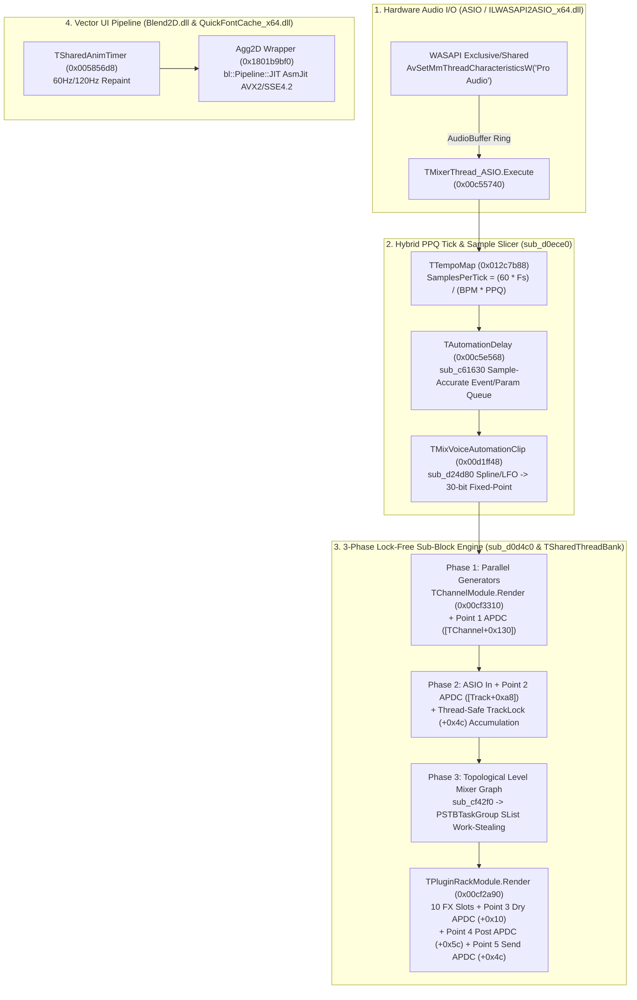

# Bước 4: Kiến Trúc Nhân DAW, Đồ Thị Âm Thanh Đa Luồng, APDC, Vector UI & Giải Mã DSP Plugins — FL Studio 26 (v26.1.7.5654)

> **Phạm vi nghiên cứu Clean-Room**: Phân tích tĩnh toàn diện (PE/COFF headers, Exports/Imports, Embarcadero Delphi x64 VMT/RTTI, MSVC C++ RTTI `CompleteObjectLocator`, và decompile mã máy bằng [`craft-anything-cli.exe`](file:///f:/FL%20studio/craft-anything/target/release/craft-anything-cli.exe) & [`rea.mjs`](file:///f:/FL%20studio/rea/scripts/rea.mjs)) trên bộ cài đã giải nén tại [`f:\FL studio\extracted_targets\flstudio26`](file:///f:/FL%20studio/extracted_targets/flstudio26).

---

## 1. Kiến Trúc Nhân DAW & Hệ Thống Core Binaries (`FLEngine_x64.dll` & Modules)

### 1.1. Bảng Kiểm Kê Nhị Phân Cốt Lõi (Core Engine Binaries)

| Binary | Kích thước (Bytes) | SHA-256 | ImageBase | Đặc trưng Kiến trúc / Sections & Exports chính |
|---|---:|---|---|---|
| [`FL64.exe`](file:///f:/FL%20studio/extracted_targets/flstudio26/FL64.exe) | `597,064` | `a1f3f53cb8ee1bb80fdfe1814876e268730f8b6bdba95e3d4a8bcba6600255e6` | `0x140000000` | Entry `RVA = 0x30ed4`. Thin loader (Delphi x64), nạp động `FLEngine_x64.dll` và gọi `CreateFruityInstance`. |
| [`FLEngine_x64.dll`](file:///f:/FL%20studio/extracted_targets/flstudio26/FLEngine_x64.dll) | `22,227,016` | `6d9c5ab09c1d5594012ac2c31cf9ed08e73f42164ed0964cccae10a95d9b8e02` | `0x00400000` | `.text` `0x1000` (`16,397,552 B`), `.data` `0xfa5000` (`2,359,304 B`), `.bss` `0x11e6000` (`3,706,524 B`). Exports: `CreateFruityInstance` (`0x13759d0`), `__dbk_fcall_wrapper` (`0x41d5a0`), `dbkFCallWrapperAddr` (`0x15ec2b0`). Chứa **2,931 class Delphi x64**. |
| [`dsp_ippv2_x64.dll`](file:///f:/FL%20studio/extracted_targets/flstudio26/dsp_ippv2_x64.dll) | `39,942,656` | `4dbb9e954f5cc3c83e7d40872a7d616d5e6fb6280b3d377260c9438ae551e0d4` | `0x180000000` | `.text` `0x1000` (`0x17de140 B`), `IPPCODE` `0x17e0000` (`0x6dc771 B`), `.rdata` `0x1ebd000` (`0x6837de B`). **446 Exports**: Ord 1 `AggCreateInstance` (`0x1817c82f0`), Ord 2–9 IPP CPU/FP control (`ippSetCpuFeatures` `0x180001000`, `ippSetFlushToZero` `0x180743560`, `ippSetDenormAreZeros` `0x180743600`), Ord 10–80 `ippi*`, Ord 81–446 `ipps*` (FFT, FIR, BiQuad IIR, Up/DownSample, Kaiser/Blackman windows). |
| [`Blend2D.dll`](file:///f:/FL%20studio/extracted_targets/flstudio26/Blend2D.dll) | `2,065,920` | `66634d24412084b7541b4b27a11be8b0f4cb90d844c87e1ee5e5c3ecd66066c7` | `0x180000000` | `.text` `0x1000` (`0x1b5205 B`), `.rdata` `0x1b7000` (`0x38cd4 B`), `.data` `0x1f0000` (`0x104bb4 B`). Export duy nhất: `AggCreateInstance` (`0x180059a60`). Chứa **47 class C++ RTTI** (`bl::Pipeline::JIT::*`, `asmjit::_abi_1_13::x86::Compiler`). |
| [`ILWASAPI2ASIO_x64.dll`](file:///f:/FL%20studio/extracted_targets/flstudio26/System/Plugin/ASIO/ILWASAPI2ASIO_x64.dll) | `531,456` | `4aed6715d71f7bbb27870652337446b045c79b1ff1950a2e41c4109adae9df01` | `0x180000000` | `.text` `0x1000` (`0x630a0 B`). **5 COM Exports**: `DllRegisterServer` (`0x1800030c0`), `DllUnregisterServer` (`0x1800031b0`), `DllCanUnloadNow` (`0x180001fd0`), `DllGetClassObject` (`0x180001ff0`), `DllMain` (`0x180002e10`). **23 class C++ RTTI** (`ILWasapiToAsioDriver`, `WASAPIWrapper`). |
| [`QuickFontCache_x64.dll`](file:///f:/FL%20studio/extracted_targets/flstudio26/QuickFontCache_x64.dll) | `2,067,968` | `720fa3e0c29b1dee0b53162d5d137311690c78cb85711392bb80cd5932fd3d40` | `0x00400000` | `.text` `0x1000` (`0x1a8098 B`). **10 Exports**: `AcquireSharedThreadBank` (`0x585190`), `AcquireSharedAnimTimer` (`0x5864f0`), `LoadSharedElastiqueDll` (`0x586c90`), `CreateVST3Instance` (`0x58a200`), `InitSharedPython` (`0x59a2b0`), `FontCache_AcquireFont` (`0x57f7f0`). Chứa **441 class Delphi x64**. |
| [`freetype_x64.dll`](file:///f:/FL%20studio/extracted_targets/flstudio26/freetype_x64.dll) | `607,032` | `6ea6c106ad2695b5ec75738a0c790bba81dca7866d63254c2c69602973837cb8` | `0x180000000` | `.text` `0x1000` (`0x6341e B`). **271 exports** FreeType2 (`FT_Load_Glyph` `0x180005160`, `FT_Render_Glyph` `0x180006dd0`, `FTC_CMapCache_Lookup` `0x18001cee0`). |

---

### 1.2. Kiến Trúc Mixer 500 Insert Tracks & Lập Lịch Đa Luồng (`TSharedThreadBank`)

#### A. Cấu trúc Bộ nhớ Mảng 502 Mixer Tracks (`VA = 0x15e06a0`)
Trong [`FLEngine_x64.dll`](file:///f:/FL%20studio/extracted_targets/flstudio26/FLEngine_x64.dll), con trỏ toàn cục tại `0x15e06a0` trỏ tới mảng liên tục gồm **`0x1f6 = 502` phần tử `TMixerTrack`** (chứng minh tại vòng lặp cấp phát `sub_d0cee0`: chỉ số `0` = Master, `1..500` (`0x1f4`) = 500 Insert Tracks, `501` (`0x1f5`) = Current/Preview Track). Mỗi `TMixerTrack` có kích thước cố định **`0x1478` bytes (`5,240 B`**, nhân chỉ số với `0x28f * 8` trong `sub_c55740`, `sub_cf42f0`, `sub_d0d4c0`):

| Offset | Kiểu | Trường | Vai trò trong Engine (Chứng minh từ Decompilation) |
|---|---|---|---|
| `+0x34` | `PWAV32FS` | `CurrentSubBlockBuf` | Buffer stereo interleaved (`[f32; 2]`) của sub-block hiện tại; dịch thêm `slice_len * 8` bytes sau mỗi tick slice (`0xd0ecbf`). |
| `+0x3c`, `+0x44` | `PWAV32FS` | `ScratchBuf1`, `ScratchBuf2` | Hai buffer phụ cấp phát tại `sub_d0cee0` phục vụ mix/swap nội bộ. |
| `+0x4c` | `TRTLCriticalSection` | `TrackLock` | Khóa đồng bộ khi nhiều `TChannel` cộng dồn vào cùng một Mixer Track (`0xd0e3c7`) hoặc khi plugin không an toàn luồng (`0xcf2dba`). |
| `+0xa8` | `TBasicDelay_32FS*` | `InputAPDCDelayLine` | Delay line bù trễ APDC đầu vào của Mixer Track (`0xd0e2ea` gọi `sub_9803f0`). |
| `+0xc8` | `TArray<int32_t>` | `ASIOOutChannelIndices` | Danh sách cặp kênh phần cứng ASIO Output gắn với track (`0xc5585f`). |
| `+0xd0` | `PWAV32FS*` | `ASIOOutBuffers` | Con trỏ tới các buffer đầu ra ASIO (`0xd0ebee`). |
| `+0xe0` | `int32_t` | `ASIOInChannelIndex` | Chỉ số kênh ASIO Input (`< 0` nếu không gán, kiểm tra tại `0xc557dd`). |
| `+0xe4`, `+0xec` | `float*`, `float*` | `ASIOInBufL`, `ASIOInBufR` | Con trỏ kênh Trái/Phải từ ASIO Input (`0xc55805`, convert/de-interleave tại `0xd0e28b`). |
| `+0x130` | `TMixerRoutingTable*` | `RoutingTable` | Bảng định tuyến Sends / Sidechains từ track này sang các track đích (`0xd0cfd5`). |
| `+0x148` | `uint32_t` | `BufferActivityState` | `0` = Im lặng (Silent), `2` = Có tín hiệu âm thanh hoạt động (`0xd0e2d9`, `0xd0e3db`). |
| `+0x150` | `uint8_t` | `NeedsClearFlag` | Cờ báo cần xóa buffer bằng `ZeroBuffer` trước khi cộng dồn (`0xcf441f`, `0xd0e2c3`). |
| `+0x1c0` | `TMixerTrackModule*` | `ProcessingModule` | Node `TMixerTrackModule` (`VMT = 0x01276868`, Size `0x30`) trong đồ thị đa luồng. |
| `+0x1c8` | `float` | `PostFaderPeakR` | Đỉnh âm lượng kênh Phải (`0xd0eb86`). |
| `+0x134c` | `TPluginSlot*[10]` | `PluginSlots` | Mảng 10 FX Slots (`0..9`) trên Mixer Track (`0xd0cff2`). |

#### B. Phân cấp `TProcessingModule` & Lập lịch Lock-Free SList (`QuickThreads.PSTBTaskGroup`)
```text
TObject
 └── TProcessingModule (VMT = 0x00cf2488, Size = 0x10 = 16 B, vfn[0] = 0x0040c820 _AbstractError)
      ├── TPluginModule (VMT = 0x00cf25b8, Size = 0x40 = 64 B, vfn[0] = 0x0040c820)
      │    ├── TPluginRackModule (VMT = 0x00cf26e0, Size = 0x70 = 112 B, vfn[0] = 0x00cf2a90)
      │    └── TChannelModule    (VMT = 0x00cf2830, Size = 0x50 = 80 B,  vfn[0] = 0x00cf3310)
      └── TMixerTrackModule      (VMT = 0x01276868, Size = 0x30 = 48 B,  vfn[0] = 0x01276ce0 -> sub_1276ee0)
```
Trong [`QuickFontCache_x64.dll`](file:///f:/FL%20studio/extracted_targets/flstudio26/QuickFontCache_x64.dll), `AcquireSharedThreadBank` (`0x00585190`) khởi tạo singleton **`TSharedThreadBank`** (`VMT = 0x00584720`, `Size = 0x48`) quản lý mảng worker **`TSTBThread`** (`VMT = 0x00584578`, `Size = 0x70`, `Execute = 0x005849c0`):
- **`TSharedThreadBank.SubmitTaskGroup` (`vfn[2] = 0x00584f60`)**: Nhận `PSTBTaskGroup`, đẩy từng `TSTBTask` vào Win32 Lock-Free Singly-Linked List (`RtlInterlockedPushEntrySList` tại `self + 0x30`), tăng biến đếm công việc bằng `lock xadd [self + 0x24], eax` và đánh thức worker qua `ReleaseSemaphore([self + 0x18], count, NULL)`.
- **`TSTBThread.Execute` (`0x005849c0`)**: Ngủ trên `WaitForSingleObject([rsi + 0x20], INFINITE)`, sau đó gọi `sub_584ed0` dùng `RtlInterlockedPopEntrySList` lấy `TSTBTask` thực thi và giảm biến đếm của `TSTBTaskGroup` bằng `lock xadd [group + 0x08], -1`.
- **`TSharedThreadBank.WaitForTaskGroup` (`vfn[3] = 0x005850b0`)**: Luồng Audio chính **work-stealing** (trực tiếp gọi `sub_584ed0` rút task từ SList ra chạy) rồi spin-wait (`pause` + `SwitchToThread`) cho tới khi `[TaskGroup + 0x08] == 0`.
- **Thực thi 3 Pha trong `sub_d0d4c0` (`0x00d0d4c0`)**:
  1. **Pha 1 — Multi-threaded Generators (`0xd0e22f`)**: Duyệt danh sách các bậc của `TChannelModule`, gọi `sub_666a30(*(uint64_t*)0x15e30e0, LevelTaskGroup)` để chạy song song `TChannelModule.Render` (`0x00cf3310`) trên toàn bộ core CPU.
  2. **Pha 2 — ASIO Input & Channel-to-Mixer Accumulation (`0xd0e24b`–`0xd0e485`)**: Đọc ASIO Input (`0xd0e28b`), áp dụng Input APDC (`[TMixerTrack + 0xa8]`), và cộng dồn đầu ra các `TChannel` vào `TMixerTrack` đích (bảo vệ bằng `TrackLock` `+0x4c`).
  3. **Pha 3 — Topological Level-Order Mixer Graph (`sub_cf42f0` tại `0x00cf42f0`)**: Biến toàn cục `0x15e06f8` trỏ tới mảng các bậc độc lập (`*(uint32_t*)0x16b8dcc` bậc), mỗi bậc 16 bytes (`+0x00`: `TArray<TProcessingModule>`, `+0x08`: `PSTBTaskGroup`). Nếu bật Multithreaded Mixer (`byte [0x1504ed8] & 2` và `*(uint32_t*)0x16b8dd0 > 1`), `sub_cf4250` gọi `sub_666a30` đẩy `PSTBTaskGroup` của bậc `k` vào `TSharedThreadBank` và đợi toàn bộ node trong bậc `k` hoàn tất (`WaitForTaskGroup`) trước khi chuyển sang bậc `k + 1`.

---

### 1.3. Cơ Chế Bù Trễ Tự Động 5 Điểm (5-Point APDC Architecture)

Mọi đường trễ âm thanh APDC trong `FLEngine_x64.dll` đều là thực thể của **`TBasicDelay_32FS`** (`VMT = 0x009287a0`, `Size = 0x58` = 88 B, kế thừa `TBaseDelayLine` `VMT = 0x00928678`, `Size = 0x38`, khởi tạo tại `sub_9289b0`, cấp phát ring buffer tại `sub_928820`). Cấu trúc `TBasicDelay_32FS`:
- `+0x08`: `float* BufferBase` (con trỏ đầu ring buffer stereo 32-bit float).
- `+0x10`: `float* BufferEnd` (`BufferBase + DelaySamples * 2`).
- `+0x18`: `float* WriteCursor` (con trỏ đọc/ghi hiện tại trong ring buffer).
- `+0x20`: `uint32_t DelaySamples`, `+0x24`: `uint32_t Channels` (`2` cho stereo).
- `+0x30` / `+0x38`: Closure `TMethod` (`Code = 0x00928ab0` hoặc `0x00928b00`, `Self = instance`) thực hiện hoán đổi in-place giữa buffer hiện tại và ring buffer (trampoline `sub_9803f0`: `mov r9, rdx; jmp qword ptr [rcx+0x30]`); `+0x40`: `ProcessReplace` (`0x00928b60`).

**5 Điểm Chèn Bù Trễ APDC trong `FLEngine_x64.dll`**:
1. **Point 1 — Channel Output Delay (`[TChannel + 0x130]`, `0x00cf33b0`)**: Bù trễ ngay sau khi Generator render xong (`sub_9803f0(*(TBasicDelay_32FS**)(Channel + 0x130), OutBuf, SliceLen)`).
2. **Point 2 — Mixer Track Hardware Input Delay (`[TMixerTrack + 0xa8]`, `0x00d0e2ea`)**: Bù trễ cho tín hiệu thu âm trực tiếp từ cổng vào ASIO trước khi trộn với các Generator.
3. **Point 3 — Plugin Rack Dry/Mix Parallel Delay (`[TPluginRackModule + 0x10]`, `0x00cf2c60`)**: Khi một FX Slot trên Mixer Track có `WetMix < 1.0` và plugin bên trong có độ trễ $L_{\text{plug}} > 0$, nhánh tín hiệu Dry (`+0x28`) được đẩy qua `TBasicDelay_32FS` tại `[Module + 0x10]` để đồng pha tuyệt đối với nhánh Wet trước khi nội suy tuyến tính (`sub_982e60`).
4. **Point 4 — Plugin Rack Post-Chain Delay (`[TPluginRackModule + 0x5c]`, `0x00cf2d00`)**: Bù trễ ở cuối chuỗi 10 FX Slots của một Mixer Track.
5. **Point 5 — Inter-Track Send / Sidechain / Multi-Out Delay (`0x00cf2cb0` & `0x00cf33e5`)**: Mảng các cặp `(TBasicDelay_32FS*, BufferPtr)` (mỗi phần tử 16 bytes) tại `[TPluginRackModule + 0x4c]` (quản lý bởi `TObjectList` tại `+0x54`) bù trễ riêng biệt cho từng đường Send/Sidechain lệch bậc đồ thị.
- **Bù trễ Sự kiện & Automation (`TAutomationDelay`, `VMT = 0x00c5e568`, `Size = 0x50`, Global `0x15e3510`)**: Khi cờ `byte [0x1505354] != 0`, `sub_d0ece0` gọi `sub_c61630(AutomationDelay, CurrentSamplePos + SliceLen)` để xả hai hàng đợi sự kiện theo timestamp mẫu: `sub_c61970` (hàng đợi Voice/MIDI/Mute tại `+0x20`) và `sub_c61660` (hàng đợi tham số plugin tại `+0x18` kèm từ điển `TDictionary<Integer, AutomationDelay.TEventIDValueRec>` tại `+0x30`, `VMT = 0x00c60280`).

---

### 1.4. Hệ Thống Định Thời Lai PPQ Tick & Sub-Block Slicer (`sub_d0ece0`)

Trong hàm điều phối trung tâm `sub_d0ece0` (`0x00d0ece0`), một khối âm thanh phần cứng ASIO kích thước `TotalFrames` được chia nhỏ tại ranh giới các xung nhịp **PPQ Tick**:
- **Các biến trạng thái toàn cục trong `.bss`**:
  - `0x15e0b78` (`int32_t`): `CurrentSamplePos` — Vị trí mẫu hiện tại trong chu kỳ cắt lát.
  - `0x15e1a00` (`int32_t`): `NextTickSamplePos` — Vị trí mẫu nơi PPQ tick tiếp theo xảy ra.
  - `0x15e3450` (`double` / `f64`): `TickSampleAccumulator` — Bộ cộng dồn mẫu dấu phẩy động 64-bit chính xác cao.
  - `0x15e2600` (`double` / `f64`): `SamplesPerTick` — Số mẫu trên một xung PPQ:
    $$\text{SamplesPerTick} = \frac{60.0 \times f_s}{\text{BPM} \times \text{PPQ}}$$
  - `0x15e3aa0` (`int32_t`): `GlobalPPQTickCounter` — Bộ đếm PPQ tick toàn cục.
  - `0x15e1b90` (`uint8_t`): Cờ căn chỉnh SIMD 8-sample (`NextTickSamplePos = Round(TickSampleAccumulator * scale) << 3` tại `0xd0f08b`).
- **Các lớp quản lý bản đồ Tempo**:
  - **`TTempoMap`** (`VMT = 0x012c7b88`, `Size = 0x68` = 104 B, kế thừa `TTempoMapIf` `0x00975508`, `vfn = [0x12c8850, 0x12c7d00, 0x12c7ec0, 0x12c8380, 0x12c84f0]`).
  - **`TFLStudioTempoMap`** (`VMT = 0x00b444e0`, `Size = 0x20` = 32 B, kế thừa `IFLStudioTempoMap` `0x00ad1608`, `vfn = [0xb59e70, 0xb59cc0, 0xb59e90, 0xb59da0, 0xb59dd0]`).
- Tại mỗi biên Tick (`0xd0ef28`), engine xử lý sự kiện Playlist/Pattern (`sub_d0e700`), cập nhật Automation/Internal Controllers, làm tròn vị trí mẫu bằng `cvtss2si` (`0xd0eff6`), rồi gọi `sub_d0d4c0(SliceSamples)` để render đúng lát cắt `SliceSamples` trước khi dịch con trỏ buffer `+0x34` của toàn bộ 502 `TMixerTrack` thêm `SliceSamples * 8` bytes (`sub_d0eb10`).

---

### 1.5. Automation Clips & Internal Controllers (`TMixVoiceAutomationClip`)

```text
TObject
 ├── TCustomMEnvelope (VMT = 0x00b97320, Size = 0xa0 = 160 B)
 │    └── TMEnvelope  (VMT = 0x00b97508, Size = 0xd0 = 208 B)
 │         ├── TMLFO  (VMT = 0x00b976a8, Size = 0xf0 = 240 B)
 │         └── TMMap  (VMT = 0x00b97838, Size = 0xc8 = 200 B)
 ├── TArticulator     (VMT = 0x00b979e8, Size = 0x38 = 56 B)
 │    └── TACArticulator (VMT = 0x00fe2580, Size = 0x40 = 64 B)
 └── TMixVoice        (VMT = 0x00d1fda8, Size = 0x2b0 = 688 B)
      └── TMixVoiceAutomationClip (VMT = 0x00d1ff48, Size = 0x398 = 920 B, vfn[0] = 0x00d275f0)
```
Trong `sub_d24d80` (`0x00d24d80`), `TMixVoiceAutomationClip` tính toán vị trí thời gian chính xác bằng số thực dấu phẩy động kép (`double` / `xmm6`) trên đối tượng `TACArticulator` / `TMEnvelope`, đánh giá giá trị đường cong Spline + LFO, nhân với hệ số tỉ lệ `0x40000000` (`1073741824.0`, 30-bit fixed-point internal controller range), chuyển thành số nguyên `int32_t` qua `sub_40a1e0` (`round`) và phát vào bus Internal Controller qua `vfn` `+0x298` để điều khiển mọi tham số liên kết.

---

### 1.6. Quản Lý Bộ Đệm ASIO / WASAPI (`ILWASAPI2ASIO_x64.dll` & `TMixerThread_ASIO`)

1. **`TMixerThread_ASIO.Execute` (`0x00c55740`, `VMT = 0x00c54d48`, `Size = 0x60`)**:
   - Đợi sự kiện `bufferSwitch` từ driver ASIO (`WaitForSingleObject`), lấy khóa mixer (`sub_9609e0`), kiểm tra chống tràn đệ quy tại `0x16b8aa8`.
   - Ánh xạ các kênh ASIO Input/Output vào `TMixerTrack[0..500]` (`+0xe4`/`+0xec` và `+0xd0`), gọi `sub_d0ece0` để chạy toàn bộ chu kỳ render của DAW, sau đó chuyển đổi định dạng mẫu từ float32 (`±1.0`) sang định dạng mẫu phần cứng ASIO (`ASIOSTInt32LSB`, `ASIOSTInt24LSB`, `ASIOSTFloat32LSB`) qua `sub_c54df0`.
2. **`ILWASAPI2ASIO_x64.dll` (`WASAPIWrapper::AudioThreadProc` tại `0x180006690`)**:
   - C++ RTTI VTables: `CBaseObject` (`0x180065648`), `CUnknown` (`0x180065658`), `CClassFactory` (`0x180065698`), `ILWasapiToAsioDriver` (`0x1800657e0` `CUnknown` / `0x1800658a8` `IASIO` / `0x1800658d0` `WASAPIWrapper::Client`), `WASAPIWrapper` (`0x180065be8`), `RenderDevice` (`0x180065c80`), `CaptureDevice` (`0x180065d28`), `DeviceList` (`0x180065dd0`), `AudioBuffer` (`0x180065de0`).
   - Trong `0x180006690`: Khởi tạo COM `CoInitializeEx(NULL, COINIT_MULTITHREADED)`, đăng ký luồng Pro Audio qua `AvSetMmThreadCharacteristicsW(L"Pro Audio", &TaskIndex)`, chạy vòng lặp sự kiện `WaitForMultipleObjects` trên `IAudioCaptureClient` / `IAudioRenderClient`, dùng bộ đệm vòng `AudioBuffer` (`0x1800083c0` / `0x180008430`) để gom/cắt các gói WASAPI thành kích thước khối lũy thừa của 2 và gọi callback `IASIO::bufferSwitch`.

---

### 1.7. Pipeline Đồ Họa Vector 2D JIT (`Blend2D.dll` & `QuickFontCache_x64.dll`)

1. **`Blend2D.dll` (`AggCreateInstance = 0x180059a60`, `Agg2D::Agg2D = 0x1800568a0`)**:
   - FL Studio 26 thay thế hoàn toàn engine Anti-Grain Geometry (AGG) cũ bằng **Blend2D JIT** nhưng giữ nguyên ABI `Agg2D` (`Size = 0x240 = 576 B`, `VT = 0x1801b9bf0`) để tương thích ngược với toàn bộ control `TVectorControl` trong `FLEngine_x64.dll` và các plugin.
   - Bố cục `Agg2D` (`0x240` bytes): `+0x00` `vtable` (`0x1801b9bf0`, 102 hàm ảo vẽ đường cong, gradient, ảnh, blend mode), `+0x08` `BLImageCore` (khởi tạo từ mẫu `0x1801f2880`), `+0x18` `BLContextCore` (khởi tạo từ mẫu `0x1801f2e30`), `+0x28` `BLPathCore`, `+0x140` `GraphicState` (`sub_180072b50`).
   - **JIT Rasterizer (`bl::Pipeline::JIT`)**: Sử dụng `asmjit::_abi_1_13::x86::Compiler` (`VT = 0x1801de858`) và `Assembler` (`VT = 0x1801de788`) để biên dịch nóng (JIT) các tổ hợp `CompOpPart` (`0x1801dc650`), `FetchLinearGradientPart` (`0x1801dc9a8`), `FetchRadialGradientPart` (`0x1801dc948`), `FetchConicGradientPart` (`0x1801dc8e8`), `FetchPixelPtrPart` (`0x1801dce98`), `FillAnalyticPart` (`0x1801dcf90`) thành mã máy AVX2/SSE4.2 chạy trực tiếp trên đa luồng worker.
2. **`QuickFontCache_x64.dll`**:
   - Cung cấp bộ đệm glyph FreeType2 (`FontCache_AcquireFont = 0x0057f7f0`, `TQuickFontCache` `VMT = 0x0057dc78`) và bộ đếm nhịp hoạt ảnh toàn cục **`TSharedAnimTimer`** (`AcquireSharedAnimTimer = 0x005864f0`, `VMT = 0x005856d8`, `Size = 0x80` = 128 B, chạy trên `TTimerThread` `VMT = 0x00585598`, `Execute = 0x00585bd0`) điều phối 60Hz/120Hz repaint cho toàn bộ giao diện DAW và plugin.

---

## 2. Fruity Plug-in SDK ABI (`TFruityPlug` / `TFruityPlugHost`) & Giải Mã 8 Native DSP Plugins

### 2.1. Đặc Tả Nhị Phân Giao Tiếp Fruity Plug-in SDK (`TFruityPlug` & `TFruityPlugHost`)

Mọi plugin gốc của FL Studio 26 đều xuất hàm `CreatePlugInstance(Host: TFruityPlugHost; Tag: TPluginTag): TFruityPlug` (x64 Windows ABI: `rcx = Host`, `rdx = Tag`). Lớp cơ sở `TDelphiFruityPlug` (`Size = 0x128` hoặc `0x130`) kế thừa `TFruityPlug` (`Size = 0xb0 = 176 B`), lưu `HostTag` tại `+0x08`, `Info: PFruityPlugInfo` tại `+0x10`, `Host: TFruityPlugHost` tại `+0xbc`, và khóa `TLock` tại `+0x124`:

| VMT Offset | Index | Phương thức `TFruityPlug` | Chữ ký x64 (`rcx = Self`) & Vai trò |
|---|---|---|---|
| `+0x00` | `vfn[0]` | `DestroyAll` | `procedure(Self)` — Giải phóng plugin instance. |
| `+0x08` | `vfn[1]` | `Dispatcher` | `function(Self; ID, Index, Value: IntPtr): IntPtr` — Nhận lệnh từ Host (`FHD_SetNumParams`, `FHD_GetParamMenu`, `FHD_SetSampleRate`, `FHD_GetDelay`...). |
| `+0x10` | `vfn[2]` | `Idle_Public` | `procedure(Self)` — Cập nhật giao diện/metering trên luồng UI. |
| `+0x18` | `vfn[3]` | `SaveRestoreState` | `procedure(Self; Stream: IStream; Save: LongBool)` — Tuần tự hóa trạng thái preset. |
| `+0x20` | `vfn[4]` | `GetName` | `function(Self; Section, Index, Value: Integer; Name: PAnsiChar): IntPtr`. |
| `+0x28` | `vfn[5]` | `ProcessEvent` | `function(Self; EventID, EventValue, Flags: Integer): Integer`. |
| `+0x30` | `vfn[6]` | `ProcessParam` | `function(Self; Index, Value, RECFlags: Integer): Integer` (`REC_UpdateValue = 1`, `REC_GetValue = 2`, `REC_ShowHint = 4`, `REC_UpdateControl = 16`, `REC_FromMIDI = 32`). |
| `+0x38` | `vfn[7]` | `Eff_Render` | `procedure(Self; SourceBuffer, DestBuffer: PWAV32FS; Length: Integer)` — Render cho Effect plugin. |
| `+0x40` | `vfn[8]` | `Gen_Render` | `procedure(Self; DestBuffer: PWAV32FS; var Length: Integer)` — Render cho Generator plugin. |
| `+0x48`..`+0x60` | `vfn[9..12]` | `TriggerVoice` / `Voice_*` | Quản lý vòng đời per-voice (`TriggerVoice`, `Voice_Release`, `Voice_Kill`, `Voice_ProcessEvent`). |
| `+0x68` | `vfn[13]` | `Voice_Render` | `function(Self; Handle: TVoiceHandle; DestBuffer: PWAV32FS; var Length: Integer): Integer`. |
| `+0x70` | `vfn[14]` | `NewTick` | `procedure(Self)` — Được gọi tại mỗi ranh giới xung nhịp PPQ Tick. |
| `+0x78` | `vfn[15]` | `MIDITick` | `procedure(Self)` — Xử lý xung MIDI độ phân giải cao. |
| `+0x80` | `vfn[16]` | `MIDIIn` | `procedure(Self; var Msg: Integer)` — Nhận thông điệp MIDI trực tiếp. |
| `+0x88` | `vfn[17]` | `MsgIn` | `function(Self; Msg: IntPtr): IntPtr` — Nhận thông điệp nội bộ. |

Trong `TFruityPlugHost` (`[Self + 0xbc]`), hai hàm ảo cốt lõi phục vụ Multi-IO / Sidechain là:
- **`GetInBuffer` (`VMT + 0x120`)**: `function(Host; Tag: TPluginTag; Index: Integer; out Offset: PWAV32FS): Boolean` — Lấy buffer đầu vào phụ (Sidechain Input).
- **`GetOutBuffer` (`VMT + 0x128`)**: `function(Host; Tag: TPluginTag; Index: Integer; out Offset: PWAV32FS): Boolean` — Lấy buffer đầu ra phụ (Auxiliary / Band Split Send).

---

### 2.2. Bảng Kiểm Kê 8 Native DSP Plugins & Thư Viện DSP Đi Kèm

| Binary | Kích thước (Bytes) | SHA-256 | `CreatePlugInstance` | Class Chính (`VMT`, `Size`) & Các hàm VMT cốt lõi |
|---|---:|---|---|---|
| [`Patcher_x64.dll`](file:///f:/FL%20studio/extracted_targets/flstudio26/Patcher_x64.dll) | `12,188,696` | `3da00bc3339f9a26d09fd53564c0065645520c64b04e3b8d9a39ca7b89c80ff0` | `0x00954040` | `TTestPlug` (`0x0094d598`, `0x4238 B`), `Eff_Render = 0x0094ebd0`, `Gen_Render = 0x0094edf0`, `ProcessParam = 0x0094ea00`. |
| [`Fruity Parametric EQ 2_x64.dll`](file:///f:/FL%20studio/extracted_targets/flstudio26/Fruity%20Parametric%20EQ%202_x64.dll) | `7,418,904` | `ffaa19e7a27e30f99102165c4b13c6371a79d15e7f34e3e8a4a2a0fb7eb3364b` | `0x006f5860` | `TParametricEQ2` (`0x006eef18`, `0x1a98 B`), `Eff_Render = 0x006f0da0`, `ProcessParam = 0x006ef6f0`. |
| [`Maximus_x64.dll`](file:///f:/FL%20studio/extracted_targets/flstudio26/Maximus_x64.dll) | `9,040,920` | `66a8f1dc60955a3c4ea0eb0137ebae6b8681f90c05efcd0fd4b2fb6c44931d6c` | `0x0084c470` | `TMaximus` (`0x00841ac8`, `0x3cd8 B`), `Eff_Render = 0x00844380`, `ProcessParam = 0x00842480`, `NewTick = 0x00844fb0`. |
| [`Emphasis_x64.dll`](file:///f:/FL%20studio/extracted_targets/flstudio26/Emphasis_x64.dll) | `7,909,912` | `1545beee4f5086a2f6ed623a6f7f78df3bd8db7313d02f807bb2e3883cf3d689` | `0x007152e0` | `TEmphasisPlug` (`0x00705ab8`, `0x220 B`), `Eff_Render = 0x00707240`, `ProcessParam = 0x007063a0`. Nạp `ildsp_x64.dll`. |
| `ildsp_x64.dll` (NSIS `809398253`) | `4,197,376` | `3da6e1c6c61fbcf958e52d4f0cfbe5db9d340147f941bb9ca7fa5001389e9745` | *(10 C++ Factory Exports)* | `Limiter_CreateInstance` (`0x1801aafd0`), `LimiterLite_CreateInstance` (`0x1801aa540`), `Shimmer_CreateInstance` (`0x1801ab810`), `WaveformColouring_CreateInstance` (`0x1801ac470`). |
| [`Frequency Splitter_x64.dll`](file:///f:/FL%20studio/extracted_targets/flstudio26/Frequency%20Splitter_x64.dll) | `8,139,800` | `f6ef39fd164552fd27d7eb2dd80edecbd9be2426000438a8569bc46559d6d0e1` | `0x0074e6c0` | `TFrequencySplitter` (`0x00740748`, `0x250 B`), `Eff_Render = 0x007423b0`, `ProcessParam = 0x00740e30`. Nạp `engine_x64.dll`. |
| `Frequency Splitter\engine_x64.dll` (NSIS `524221697`) | `3,352,064` | `567fcd74ea6cc89ad85c83953321758cab103061ed908ce468cafeebf6ae9593` | `VSTPluginMain = 0x1801e8bd0` | **4 Exports**: `VSTPluginMain` (`0x1801e8bd0`), `main` (`0x1801e8bd0`), `dispatch` (`0x1801e0d90`), `mydispatcher` (`0x1801e1e50`). Class `MyPlugin` (`VT = 0x1803016f8`). |
| [`Fruity Limiter_x64.dll`](file:///f:/FL%20studio/extracted_targets/flstudio26/Fruity%20Limiter_x64.dll) | `7,660,056` | `fd451ae76e88557c04d34fb26bb94f6308710fc6468ebca9006687312f388d5d` | `0x006da570` | `TFruityLimiter` (`0x006d3ca0`, `0x758 B`), `Eff_Render = 0x006d5d60`, `ProcessParam = 0x006d4490`. |
| [`Gross Beat_x64.dll`](file:///f:/FL%20studio/extracted_targets/flstudio26/Gross%20Beat_x64.dll) | `8,998,424` | `bf85bf9cbef6f05249218f8e7e9829086fd08833bbba60a6b31fb53a7f24c1fb` | `0x008469f0` | `TTestPlug` (`0x0083f0f0`, `0x740 B`), `Eff_Render = 0x008420f0`, `ProcessParam = 0x00840b20`, `NewTick = 0x00842040`. |
| [`LuxeVerb_x64.dll`](file:///f:/FL%20studio/extracted_targets/flstudio26/LuxeVerb_x64.dll) | `7,764,504` | `8a653632e149876161df8990364fc25f2d684086ca4cfeb758f74d44de5df697` | `0x00733990` | `TTestPlug` (`0x0072dd08`, `0x2a8 B`), `Eff_Render = 0x00731870`, `ProcessParam = 0x0072fe70`, `ProcessEvent = 0x0072fb50`. Nạp `ildsp_x64.dll`. |

---

### 2.3. Giải Mã Chi Tiết Kiến Trúc & Thuật Toán Của 8 Native Plugins

#### 2.3.1. `Patcher_x64.dll` — Đồ Thị Node Modular Đa Định Dạng
- **Phân cấp Class (`1,392` classes)**:
  - **Đồ thị Modular**: `TModularMap` (`VMT = 0x00790440`, `Size = 0x120`), `TModularModule` (`VMT = 0x0078fb50`, `Size = 0xc0`) $\rightarrow$ `THostModule` (`VMT = 0x0078fd88`, `Size = 0x100`) & `TModularPlugin` (`VMT = 0x007f8908`, `Size = 0xef0` = 3,824 B); `TModularInput` (`0x0078f748`, `0x70 B`) $\rightarrow$ `TModularPluginAudioInput` (`0x007f7cc0`, `0x78 B`) & `TModularPluginParamInput` (`0x007f7fa8`, `0x78 B`); `TModularOutput` (`0x0078f8a8`, `0x80 B`) $\rightarrow$ `TModularPluginAudioOutput` (`0x007f7e30`, `0x88 B`); `TModularConnection` (`0x00790010`, `0x40 B`); `TMultiBufferDelay` (`0x0078ed08`, `0x20 B`).
  - **Bọc Đa Định Dạng Plugin (`TBaseAudioPlugin`, `VMT = 0x00787f08`, `Size = 0x7a8`)**: Hỗ trợ đồng thời `TFruityPlugin` (`0x007db790`, `0xc58 B`), `TVSTPlugin` (`0x00885f88`, `0x9e0 B`), `TVST3Plugin` (`0x00907200`, `0x980 B`), **`TCLAPPlugin` (`0x0092cac8`, `0x9c8 B`)**, `TBridgedPlugin` (`0x007edea8`, `0x808 B`), và `TGenericPlugin` (`0x00927d48`, `0x7c0 B`).
  - **Bố cục đồ thị tự động**: `TSugiyamaLayout` (`0x008294b8`, `0x20 B`) $\rightarrow$ `TModularLayout` (`0x0082be08`, `0x30 B`) sắp xếp các node theo thuật toán phân lớp Sugiyama DAG.
- **Pipeline Render (`0x0094ebd0` & `sub_79cd80`)**:
  - Chống đệ quy vòng lặp bằng `lock cmpxchg [rbx + 0x188], r8d`.
  - Lấy `TModularMap` tại **`[TTestPlug + 0x4228]`** và gọi `sub_79cd80(ModularMap, Length)`: nạp các cổng Sidechain Input từ Host vào các node nguồn `[ModularMap + 0x50]`, duyệt tuần tự mảng các node đã sắp xếp topo tại **`[ModularMap + 0x60]`** (gọi `Node->vfn[13]` tại `+0x68` để render từng node và bù trễ nội bộ qua `TMultiBufferDelay`), rồi trộn ra các cổng đích tại `[ModularMap + 0x58]`.

#### 2.3.2. `Fruity Parametric EQ 2_x64.dll` — 7-Band Biquad, Oversampling 2x & Linear Phase FIR
- **Phân cấp Class (`683` classes)**: `TParametricEQ2` (`VMT = 0x006eef18`, `Size = 0x1a98` = 6,808 B), `TFFTFilter` (`VMT = 0x005e5cb8`, `Size = 0x60` = 96 B, dùng cho chế độ **Linear Phase**), `TResampler` (`VMT = 0x005de128`, `Size = 0x160` = 352 B), `TEQBandControl` (`VMT = 0x006ed180`, `Size = 0x420`).
- **Ma trận 36 Tham số (`ProcessParam = 0x006ef6f0`)**:
  - Tham số `0..34` được giải mã bằng phép chia nguyên magic `0x92492493` (`index / 7` và `index % 7`) cho **7 band độc lập** (`Band 0..6`):
    - Nhóm `0` (`Param 0..6`): Band Level/Gain.
    - Nhóm `1` (`Param 7..13`): Band Frequency.
    - Nhóm `2` (`Param 14..20`): Band Bandwidth / Q.
    - Nhóm `3` (`Param 21..27`): Filter Type (`Off, LowPass, BandPass, HighPass, Notch, LowShelf, Peaking, HighShelf`).
    - Nhóm `4` (`Param 28..34`): Filter Order / Slope (`Gentle, Normal, Steep 4, Steep 6, Steep 8`).
  - Tham số `35`: Main Output Level.
- **Pipeline Render (`0x006f0da0`)**:
  1. Kiểm tra cờ **Linear Phase** tại `byte [rbx + 0x1a31]`:
     - **Chế độ IIR Minimum Phase (`[rbx + 0x1a31] == 0`)**: Kiểm tra cờ **HQ Oversampling 2x** tại `byte [rbx + 0x1a30]`. Nếu bật, gọi `sub_6f07e0` (`ippsUpSample` lên $2f_s$), đẩy qua chuỗi 7 band Biquad IIR (`sub_6f0b00` duyệt mảng 7 band tại `rbx + 0x1ec`, mỗi band `0x90 = 144 B`), rồi downsample về $f_s$ (`sub_6f0920`). Nếu tắt HQ, lọc trực tiếp ở $f_s$ (`sub_6f0b00`).
     - **Chế độ Linear Phase (`[rbx + 0x1a31] != 0`)**: Gọi `sub_6ef310` tổng hợp đáp ứng tần số của cả 7 band thành hạt nhân FIR pha tuyến tính và thực thi tích chập FFT Overlap-Add qua 2 đối tượng `TFFTFilter` kênh Trái (`[rbx + 0x1a38]`) và Phải (`[rbx + 0x1a40]`) bằng `sub_5e5ef0`.
  2. Nếu UI đang mở, đẩy mẫu đầu vào/đầu ra vào ring buffer phổ (`rbx + 0x9fc`, kích thước `0x4000` mẫu) qua `sub_6f0c90` để vẽ heatmap FFT thời gian thực.

#### 2.3.3. `Maximus_x64.dll` — 3-Band Linkwitz-Riley / Linear Phase Crossover & Spline Waveshaper
- **Phân cấp Class (`727` classes)**: `TMaximus` (`VMT = 0x00841ac8`, `Size = 0x3cd8` = 15,576 B), `TPeakLookahead2` (`VMT = 0x0083b6d8`, `Size = 0x40`), `TRMSLookahead` (`VMT = 0x0083b870`, `Size = 0x30`), `TBasicDelay_32FS` (`VMT = 0x00789860`, `Size = 0x58`), `TFFTFilter` (`VMT = 0x005ec978`, `Size = 0x60`), `TMEnvelope` (`VMT = 0x007958b8`, `Size = 0xd0` — bản đồ đường cong nén tự do $Y = f(X)$).
- **Pipeline Render (`0x00844380`)**:
  1. Cấp phát khối bộ đệm làm việc liên tục `6 * MaxLen * 8` bytes tại `[self + 0xd4]` (`sub_8440e0`).
  2. **Crossover Splitting**:
     - Nếu tắt Linear Phase (`byte [self + 0x3bf8] == 0`): Tách dải Low / Mid / High bằng bộ lọc IIR Linkwitz-Riley (cắt Low tại `self + 0x3a64` với 4 tầng lọc nếu bậc 24dB/oct `byte [self + 0x3ab8] != 0`, cắt High tại `self + 0x3ab4`).
     - Nếu bật Linear Phase (`byte [self + 0x3bf8] != 0`): Tách dải bằng 4 bộ lọc FIR `TFFTFilter` tại `[self + 0x3c00..0x3c18]` (`sub_5ecbb0`), bù trễ tín hiệu gốc qua `TBasicDelay_32FS` tại `[self + 0x3bc8]` và tính phần dư bằng phép trừ mẫu (`*(0x8a5178)`).
  3. **Per-Band Compression & Saturation (`sub_8430b0`)**: Chạy tuần tự cho 3 dải `Low` (`0`), `Mid` (`1`), `High` (`2`), cộng 3 dải sau xử lý kèm Low-Cut (`[self + 0x3bd0]`), rồi đưa tổng tín hiệu vào dải thứ 4 là **`Master` (`3`)**: mỗi dải (`stride = 0xe18 = 3,608 B`) tính đường bao qua `TRMSLookahead` / `TPeakLookahead2`, tra bảng spline `TMEnvelope` (cho phép thực hiện đồng thời Upward Compression, Downward Compression, Gate/Expansion và Limiting), làm mượt Attack/Release kép (`REL1` / `REL2`) và áp dụng khâu bão hòa sóng đôi ngưỡng (Dual-Threshold Soft Clipper).

#### 2.3.4. `Emphasis_x64.dll` & `ildsp_x64.dll` — Multi-Stage Mastering Limiter
- **Kiến trúc `TEmphasisPlug` (`VMT = 0x00705ab8`, `Size = 0x220` = 544 B)**:
  - Nạp động `Limiter_CreateInstance` (`0x1801aafd0`) từ `ildsp_x64.dll` và lưu con trỏ wrapper (`VT = 0x1803dff48`) tại **`[self + 0x16c]`**.
  - **10 Factory Exports thực tế của `ildsp_x64.dll`**: `GeneralPitchShifter_CreateInstance` (`0x1801aa290`), `LimiterLite_CreateInstance` (`0x1801aa540`), `Limiter_CreateInstance` (`0x1801aafd0`), `LowFreqEnhancer_CreateInstance` (`0x1801ab3d0`), `PSOLA_CreateInstance` (`0x1801ab540`), `Shimmer_CreateInstance` (`0x1801ab810`), `StereoEnhancer_CreateInstance` (`0x1801abca0`), `TransientLooper_CreateInstance` (`0x1801abe00`), `Transmitter_CreateInstance` (`0x1801ac260`), `WaveformColouring_CreateInstance` (`0x1801ac470`).
  - Bên trong `ildsp_x64.dll`, `Limiter_CreateInstance` cấp phát đối tượng C++ **`Limiter`** (`VT = 0x1803ddc48`, kích thước state **`0x00a02a80 = 10,496,640 B`** $\approx 10\text{ MB}$!) kết hợp các khối con: `Lowpass1` (`0x1803ddce8`), `Highpass1` (`0x1803ddc98` — Pre-Emphasis / De-Emphasis tilt filter), `PeakHold8` (`0x1803ddb58`), `PeakHold1` (`0x1803ddbf8`), `GRStatic8` (`0x1803ddab8`), `GRStatic1` (`0x1803ddb08`), `ExpSmoother8` (`0x1803dddd8`), `ExpSmoother` (`0x1803ddba8`), `ExpSmoother1` (`0x1803dda68`), `GRAdaptiveRel` (`0x1803ddd88` — giải phóng thích ứng theo mật độ đỉnh), `DelayInt` (`0x1803dde28`), và `DelayLerp` (`0x1803ddd38` — nội suy True-Peak oversampling).
- **Pipeline Render (`0x00707240`)**:
  - Tách kênh stereo interleaved sang planar `[self + 0x134]` / `[self + 0x13c]` (`*(0x76a3e8)`).
  - Gọi `LimiterWrapper->vfn[4]` (`+0x20`, `0x1801ab080` $\rightarrow$ `Limiter::Process` `0x18016c3b0`) xử lý khối planar sang `[self + 0x144]` / `[self + 0x14c]`.
  - Gộp lại thành stereo interleaved (`*(0x76a060)`), truy vấn telemetry độ giảm âm lượng (Gain Reduction) từ `LimiterWrapper` qua các hàm ảo `+0x58`, `+0x80`, `+0x88`, `+0x90`, `+0x98`, làm mượt qua `sub_702d10` (`[self + 0x1e0..0x1f8]`) và ghi vào ring buffer đồ thị `[self + 0x1d8]` / `[self + 0x210]` (`sub_7075e0`).

#### 2.3.5. `Frequency Splitter_x64.dll` & `engine_x64.dll` — Linear/Minimum Phase Crossover & Multi-Out Sidechain Routing
- **Kiến trúc**: `TFrequencySplitter` (`VMT = 0x00740748`, `Size = 0x250` = 592 B) bọc một plugin VST2 nội bộ là `Frequency Splitter\engine_x64.dll` (`VSTPluginMain = 0x1801e8bd0`, class `MyPlugin` `VT = 0x1803016f8`, kế thừa `AudioEffectX` `0x180301d58`) tại **`[self + 0x1d0]`**.
- **Pipeline Render (`0x007423b0`)**:
  1. Tách stereo input sang 2 buffer planar `[self + 0x150]` và `[self + 0x158]` (`*(0x7a3e40)`).
  2. Gọi `[self + 0x1d0]->vfn[25]` (`+0xc8`, `ProcessReplacing`) tách tín hiệu thành **4 cặp kênh planar** tại `[self + 0x160..0x198]`: 3 dải tần Low (`0`), Mid (`1`), High (`2`) (`+0x160..+0x188`, độ dốc 6dB..96dB/oct IIR hoặc Linear Phase FIR) và cặp kênh Main Output (`+0x190..+0x198`).
  3. Duyệt 3 dải `rdi = 0..2`: nếu người dùng gán dải `rdi` ra đường Send phụ (`*(int32_t*)(self + rdi * 4 + 0x214) > 0`), gộp cặp planar của dải đó sang interleaved tại `[self + rdi * 8 + 0x1a0]`, gọi **`PlugHost->GetOutBuffer(HostTag, SendOffset, &TargetBuf)` (`+0x128`)** và cộng dồn vào `TargetBuf` (`*(0x7a3948)`).
  4. Gộp cặp planar Main Output (`+0x190`/`+0x198`) vào `[self + 0x1b8]` và xuất ra `DestBuffer`.

#### 2.3.6. `Fruity Limiter_x64.dll` — Dual Compressor/Limiter, Sparse Above-Threshold Log-Domain Solver & Lookahead
- **Phân cấp Class (`683` classes)**: `TFruityLimiter` (`VMT = 0x006d3ca0`, `Size = 0x758` = 1,880 B), `TPeakLookahead2` (`VMT = 0x006d0458`, `Size = 0x40` = 64 B, `vfn = [0x6d0550, 0x6d0710, 0x6d08d0, 0x6d0b90]`), `TRMSLookahead` (`VMT = 0x006d05f0`, `Size = 0x30` = 48 B, `vfn = [0x6d0a70, 0x6d0aa0, 0x6d0ca0, 0x6d0da0]`), `TBasicDelay_32FS` (`VMT = 0x0067cf90`, `Size = 0x58` = 88 B).
- **Pipeline Render (`0x006d5d60`)**:
  1. Tính đường bao RMS đầu vào qua `TRMSLookahead` tại `[self + 0x1c4]` (`vfn[3]` tại `+0x18`) lưu vào `WorkBuf` (`arg_40`).
  2. **Khối Compressor (`byte [self + 0x249] != 0`)**:
     - Nếu chọn Sidechain Input (`*(int32_t*)(self + 0x1c0) > 0`), gọi `PlugHost->GetInBuffer` (`+0x120`) lấy tín hiệu sidechain, tính đường bao qua `TRMSLookahead` thứ hai tại `[self + 0x1cc]` và làm mượt qua mảng `TSlewLimiter2` tại `[self + 0x1e4]` (mỗi tầng 36 bytes, gọi `*(0x72c5b8)`).
     - **Tối ưu hóa Sparse Gather/Scatter (`0x6d5fe3`–`0x6d601a`)**: Quét toàn bộ mẫu trong sub-block, **chỉ gom những mẫu vượt ngưỡng nén `[self + 0x218]`** vào mảng giá trị `rbx` kèm mảng chỉ số mẫu `rsi` (`edi` mẫu vượt ngưỡng). Chỉ khi `edi > 0` mới gọi các hàm SIMD tính hàm truyền nén log/dB, Knee (`+0x224`) và Ratio (`+0x21c`) trên đúng `edi` mẫu đó, rồi scatter ngược về `arg_48[rsi[k]]`!
  3. **Khối Lookahead Limiter (`0x6d6300`–`0x6d642b`)**:
     - Đẩy tín hiệu âm thanh qua đường trễ lookahead `TBasicDelay_32FS` tại **`[self + 0x1d4]`** (`+0x30`).
     - Đẩy đường bao qua chuỗi tầng `TPeakLookahead2` tại **`[self + 0x1dc]`** (mỗi tầng 36 bytes — chia cửa sổ Attack thành các bộ lọc cực đại trượt nối tiếp để làm tròn đỉnh).
     - Tính tỉ số giới hạn `Ceiling / Envelope` (`divss xmm0, [rbp+0x68]` với Ceiling tại `[self + 0x208]`), kết hợp Noise Gate (`[self + 0x214]`), làm mượt qua chuỗi tầng Release/Attack tại **`[self + 0x1ec]`**, nhân gain vào âm thanh đã trễ (`*(0x72c6d0)`), và áp dụng Soft Saturation (`*(0x72d5c0)` tại `self + 0x23c`) nếu `byte [self + 0x248] != 0`.

#### 2.3.7. `Gross Beat_x64.dll` — Real-Time Time-Buffer Scratching & Volume Gate Splines
- **Phân cấp Class (`1,028` classes)**: `TTestPlug` (`VMT = 0x0083f0f0`, `Size = 0x740` = 1,856 B), `TBRDelay_32FS` (`VMT = 0x0077fec8`, `Size = 0x50` = 80 B — Beat-Repeat / Scratch Circular Delay Line), `TBRResampler` (`VMT = 0x0083ed98`, `Size = 0x1a8` = 424 B, kế thừa `TResampler` `0x006133a8`), `TBRSlot` (`VMT = 0x0083eec0`, `Size = 0xf0` = 240 B — Time/Pitch Envelope Slot, kế thừa `TMMap`), `TVolMap` (`VMT = 0x00806db8`, `Size = 0xd8` = 216 B — Volume Gate Envelope Slot, kế thừa `TMMap`), `TScratchWheel` (`VMT = 0x00845b78`, `Size = 0x488`).
- **Pipeline Render (`0x008420f0`)**:
  - Ghi liên tục luồng âm thanh đầu vào vào bộ đệm vòng 2-bar `TBRDelay_32FS`.
  - Tại mỗi mẫu, nội suy vị trí pha đọc tương đối $\Delta t(n) \le 0$ từ đường cong spline của `TBRSlot` đang kích hoạt (36 slot Time, tốc độ phát tức thời $r(n) = 1.0 + \frac{d(\Delta t)}{dt}$) và hệ số khuếch đại $g(n)$ từ `TVolMap` (36 slot Volume), dùng `TBRResampler` (nội suy đa thức / Sinc có bù chống khử răng cưa và de-clicking crossfade khi nhảy pha đột ngột) để đọc mẫu từ `TBRDelay_32FS` và nhân với đường bao Volume Gate.

#### 2.3.8. `LuxeVerb_x64.dll` & `ildsp_x64.dll` — Algorithmic FDN Shimmer Reverb, Envelope Follower & Waveform Colouring
- **Phân cấp Class (`767` classes)**: `TTestPlug` (`VMT = 0x0072dd08`, `Size = 0x2a8` = 680 B, `Eff_Render = 0x00731870`, `ProcessParam = 0x0072fe70`, `ProcessEvent = 0x0072fb50`).
- **Tích hợp `ildsp_x64.dll`**:
  - Trong `0x0072dfd5`, `TTestPlug` nạp động **`Shimmer_CreateInstance` (`0x1801ab810`)** từ `ildsp_x64.dll` và lưu con trỏ đối tượng C++ (`VT = 0x1803e0068`, quản lý khối state FDN/Pitch-Shifter khổng lồ **`0x00191470 = 1,643,632 B`** $\approx 1.64\text{ MB}$ khởi tạo bởi `0x1801843b0`, tích hợp `PSOLAImpl` `VT = 0x1803e0030` và `GeneralPitchShifterImpl` `VT = 0x1803dfcf8`) vào **`[TTestPlug + 0x1b8]`**, đồng thời sử dụng `WaveformColouring_CreateInstance` (`0x1801ac470`, `VT = 0x1803e01b0`, `Size = 0x228`).
- **Pipeline Render (`0x00731870`)**:
  1. Kiểm tra chỉ số Sidechain Input tại `*(int32_t*)(self + 0x284)`: nếu `> 0`, gọi `PlugHost->GetInBuffer(HostTag, SidechainIdx, &SidechainBuf)` (`+0x120`) để lấy tín hiệu điều khiển Envelope Follower / Ducking.
  2. Lấy khóa nội bộ `[self + 0x124]->Enter()` (`vfn[0]`), gọi **`ShimmerWrapper->vfn[5]` (`+0x28` = `0x1801abad0`)** tại `[self + 0x1b8]` truyền `(Self, Length, SourceBuf, SidechainBuf, DestBuf)` để thực thi mạng hồi tiếp trễ FDN (Feedback Delay Network) tích hợp Pitch-Shifter (`PSOLA` / `GeneralPitchShifter`), bộ lọc phản xạ sớm, Modulation và Freeze, sau đó nhả khóa `[self + 0x124]->Leave()` (`vfn[1]`) và cập nhật đồ thị phổ/envelope qua `sub_731540`.

---

## 3. Sơ Đồ Kiến Trúc Tổng Thể & Đặc Tả Rust Clean-Room (`struct` / `trait`)

### 3.1. Sơ Đồ Luồng Tín Hiệu & Lập Lịch Đa Luồng (Mermaid Architecture Diagram)



---

### 3.2. Đặc Tả Rust Clean-Room Tương Đương (Production-Grade Rust Blueprint)

```rust
//! Clean-Room Rust Architecture Equivalent to FL Studio 26 (v26.1.7.5654)
//! Modules: Hybrid PPQ Slicer, Lock-Free Level-Order Audio Graph, 5-Point APDC,
//! Tension Spline Evaluator, Sparse Log-Domain Dynamics, and WGPU/Blend2D Telemetry.

use std::sync::atomic::{AtomicU32, Ordering};
use std::sync::Mutex;

pub const MAX_MIXER_TRACKS: usize = 502; // 0 = Master, 1..=500 = Insert Tracks, 501 = Current/Preview
pub const MAX_INSERT_SLOTS: usize = 10;
pub const MAX_BLOCK_SIZE: usize = 4096;
pub type StereoFrame = [f32; 2];

// ============================================================================
// 1. SAMPLE-ACCURATE CIRCULAR DELAY LINE & AUTOMATION DELAY (5-POINT APDC)
// ============================================================================

/// Tương đương `TBasicDelay_32FS` (`VMT = 0x009287a0`, `Size = 0x58` trong `FLEngine_x64.dll`).
/// Thực hiện hoán đổi in-place (read oldest + write newest) trên ring buffer liên tục.
pub struct BasicDelay32FS {
    buffer: Vec<StereoFrame>,
    write_cursor: usize,
    delay_samples: usize,
}

impl BasicDelay32FS {
    pub fn new(delay_samples: usize) -> Self {
        Self {
            buffer: vec![[0.0; 2]; delay_samples.max(1)],
            write_cursor: 0,
            delay_samples,
        }
    }

    pub fn set_delay(&mut self, delay_samples: usize) {
        if self.delay_samples != delay_samples {
            self.delay_samples = delay_samples;
            self.buffer.resize(delay_samples.max(1), [0.0; 2]);
            self.write_cursor = 0;
        }
    }

    /// Tương đương `sub_928b00` (`TBasicDelay_32FS` closure tại `+0x30`):
    /// Đọc mẫu trễ ra `io_buf` đồng thời ghi mẫu mới vào vị trí vừa đọc.
    #[inline]
    pub fn process_in_place(&mut self, io_buf: &mut [StereoFrame]) {
        if self.delay_samples == 0 {
            return;
        }
        let len = self.delay_samples;
        let mut cur = self.write_cursor;
        for frame in io_buf.iter_mut() {
            let delayed = self.buffer[cur];
            self.buffer[cur] = *frame;
            *frame = delayed;
            cur += 1;
            if cur >= len {
                cur = 0;
            }
        }
        self.write_cursor = cur;
    }
}

/// Sự kiện tham số/MIDI bù trễ mẫu chính xác (`TAutomationDelay`, `VMT = 0x00c5e568`, `Size = 0x50`).
#[derive(Clone, Copy, Debug)]
pub struct DelayedAutomationEvent {
    pub target_sample_pos: u64,
    pub plugin_id: u32,
    pub param_index: u32,
    pub value_fixed30: i32, // 0..0x40000000 (`sub_d24d80`)
}

// ============================================================================
// 2. UNIFIED PLUGIN TRAIT & INSERT RACK SLOT (WITH POINT 3 DRY/WET APDC)
// ============================================================================

/// Giao diện Plugin chuẩn hóa từ `TFruityPlug` (`Size = 0xb0`, 18 hàm ảo) & `TBaseAudioPlugin`.
pub trait AudioPluginNode: Send {
    fn latency_samples(&self) -> usize;
    fn process_param(&mut self, index: u32, value: i32, rec_flags: u32) -> i32;
    fn on_new_tick(&mut self, ppq_position: f64);
    fn render_effect(
        &mut self,
        source: &[StereoFrame],
        dest: &mut [StereoFrame],
        sidechain_in: &[&[StereoFrame]],
        aux_out: &mut [&mut [StereoFrame]],
    );
}

/// 1 trong 10 FX Slots trên `TMixerTrack` (`+0x134c`), tích hợp Point 3 Dry/Wet Parallel APDC
/// (`TPluginRackModule`, `VMT = 0x00cf26e0`, `Size = 0x70`, `Render = 0x00cf2a90`).
pub struct PluginRackSlot {
    pub plugin: Box<dyn AudioPluginNode>,
    pub enabled: bool,
    pub wet_mix: f32,
    pub dry_apdc_delay: BasicDelay32FS, // Point 3: `[TPluginRackModule + 0x10]` (`0x00cf2c60`)
    pub dry_scratch: Vec<StereoFrame>,
}

impl PluginRackSlot {
    pub fn process(&mut self, track_buf: &mut [StereoFrame], max_block: usize) {
        if !self.enabled || self.wet_mix <= 0.0 {
            return;
        }
        let n = track_buf.len();
        if self.dry_scratch.len() < max_block {
            self.dry_scratch.resize(max_block, [0.0; 2]);
        }
        let lat = self.plugin.latency_samples();
        self.dry_apdc_delay.set_delay(lat);

        if (self.wet_mix - 1.0).abs() > 1e-6 {
            let dry = &mut self.dry_scratch[..n];
            dry.copy_from_slice(track_buf);
            // Point 3 APDC: Bù trễ nhánh Dry khớp với độ trễ nội tại của Plugin
            self.dry_apdc_delay.process_in_place(dry);
            let mut wet = vec![[0.0; 2]; n];
            self.plugin.render_effect(track_buf, &mut wet, &[], &mut []);
            let w = self.wet_mix;
            let inv_w = 1.0 - w;
            for i in 0..n {
                track_buf[i][0] = dry[i][0] * inv_w + wet[i][0] * w;
                track_buf[i][1] = dry[i][1] * inv_w + wet[i][1] * w;
            }
        } else {
            let mut wet = vec![[0.0; 2]; n];
            self.plugin.render_effect(track_buf, &mut wet, &[], &mut []);
            track_buf.copy_from_slice(&wet);
        }
    }
}

// ============================================================================
// 3. MIXER TRACK & TOPOLOGICAL LEVEL-SYNCHRONOUS GRAPH SCHEDULER
// ============================================================================

/// Đường Send / Sidechain liên track có gắn Point 5 Inter-Track APDC (`[TPluginRackModule + 0x4c]`).
pub struct MixerSendRoute {
    pub dest_track_index: usize,
    pub gain: f32,
    pub is_sidechain_only: bool,
    pub send_apdc_delay: BasicDelay32FS, // Point 5 APDC (`0x00cf2cb0`)
    pub send_buffer: Vec<StereoFrame>,
}

/// Tương đương phần tử `TMixerTrack` (`Size = 0x1478 = 5,240 B` tại mảng 502 phần tử `0x15e06a0`).
pub struct MixerTrack {
    pub index: usize,
    pub sub_block_buf: Vec<StereoFrame>,      // `+0x34`
    pub track_lock: Mutex<()>,                // `+0x4c` (`TRTLCriticalSection`)
    pub input_apdc_delay: BasicDelay32FS,     // Point 2: `+0xa8` (`0x00d0e2ea`)
    pub activity_state: AtomicU32,            // `+0x148` (`0` = Silent, `2` = Active)
    pub slots: Vec<PluginRackSlot>,           // `+0x134c` (up to 10 FX slots)
    pub post_rack_apdc_delay: BasicDelay32FS, // Point 4: `[TPluginRackModule + 0x5c]` (`0x00cf2d00`)
    pub sends: Vec<MixerSendRoute>,           // `+0x130`
    pub accumulated_latency: usize,
}

impl MixerTrack {
    /// Tương đương `TPluginRackModule.Render` (`0x00cf2a90`) + `TMixerTrackModule` (`0x01276868`).
    pub fn render_slice(&mut self, slice_offset: usize, slice_len: usize, max_block: usize) {
        let buf = &mut self.sub_block_buf[slice_offset..slice_offset + slice_len];
        // Point 2: Hardware ASIO Input APDC
        self.input_apdc_delay.process_in_place(buf);

        // Chạy chuỗi 10 FX Slots (kèm Point 3 Dry/Wet APDC)
        for slot in self.slots.iter_mut() {
            slot.process(buf, max_block);
        }

        // Point 4: Post-Rack APDC
        self.post_rack_apdc_delay.process_in_place(buf);

        // Point 5: Chuẩn bị các đường Send/Sidechain đã bù trễ
        for send in self.sends.iter_mut() {
            if send.send_buffer.len() < slice_len {
                send.send_buffer.resize(slice_len, [0.0; 2]);
            }
            let sbuf = &mut send.send_buffer[..slice_len];
            for i in 0..slice_len {
                sbuf[i][0] = buf[i][0] * send.gain;
                sbuf[i][1] = buf[i][1] * send.gain;
            }
            send.send_apdc_delay.process_in_place(sbuf);
        }
    }
}

/// Bộ lập lịch đa luồng theo bậc topo (`sub_cf42f0` & `TSharedThreadBank` `0x00584720`).
pub struct TopologicalMixerScheduler {
    /// Danh sách các bậc (`0x15e06f8`, số bậc tại `0x16b8dcc`): các track trong cùng một bậc
    /// không phụ thuộc nhau và được thực thi song song hoàn toàn qua SList work-stealing.
    pub levels: Vec<Vec<usize>>,
}

impl TopologicalMixerScheduler {
    /// Phân hoạch đồ thị 502 Mixer Tracks theo thuật toán Kahn và tính toán độ trễ APDC liên track.
    pub fn rebuild_levels_and_apdc(tracks: &mut [MixerTrack]) -> Self {
        let n = tracks.len();
        let mut in_degree = vec![0usize; n];
        let mut adj = vec![Vec::<usize>::new(); n];

        for t in 0..n {
            for route in &tracks[t].sends {
                if route.dest_track_index < n && route.dest_track_index != t {
                    adj[t].push(route.dest_track_index);
                    in_degree[route.dest_track_index] += 1;
                }
            }
        }

        let mut current_level: Vec<usize> = (0..n).filter(|&i| in_degree[i] == 0).collect();
        let mut levels = Vec::new();
        let mut max_incoming_latency = vec![0usize; n];

        while !current_level.is_empty() {
            let mut next_level = Vec::new();
            for &u in &current_level {
                let mut internal_lat = 0usize;
                for slot in &tracks[u].slots {
                    if slot.enabled {
                        internal_lat += slot.plugin.latency_samples();
                    }
                }
                let total_u = max_incoming_latency[u] + internal_lat;
                tracks[u].accumulated_latency = total_u;

                for &v in &adj[u] {
                    max_incoming_latency[v] = max_incoming_latency[v].max(total_u);
                    in_degree[v] -= 1;
                    if in_degree[v] == 0 {
                        next_level.push(v);
                    }
                }
            }
            levels.push(current_level);
            current_level = next_level;
        }

        // Cập nhật Point 5 Inter-Track Send APDC cho từng nhánh Send lệch độ trễ
        for u in 0..n {
            let total_u = tracks[u].accumulated_latency;
            for send in tracks[u].sends.iter_mut() {
                if send.dest_track_index < n {
                    let target_lat = max_incoming_latency[send.dest_track_index];
                    let slack = target_lat.saturating_sub(total_u);
                    send.send_apdc_delay.set_delay(slack);
                }
            }
        }

        Self { levels }
    }
}

// ============================================================================
// 4. HYBRID PPQ TICK / SAMPLE SLICING ENGINE (`sub_d0ece0`)
// ============================================================================

pub struct HybridTickSlicer {
    pub sample_rate: f64,
    pub bpm: f64,
    pub ppq: u32,
    pub current_sample_pos: i64,    // `0x15e0b78`
    pub next_tick_sample_pos: i64,  // `0x15e1a00`
    pub tick_sample_accum_f64: f64, // `0x15e3450`
    pub samples_per_tick_f64: f64,  // `0x15e2600`
    pub global_ppq_tick: i64,       // `0x15e3aa0`
    pub simd_align_8_samples: bool, // `0x15e1b90`
}

impl HybridTickSlicer {
    pub fn new(sample_rate: f64, bpm: f64, ppq: u32) -> Self {
        let spt = (sample_rate * 60.0) / (bpm * ppq as f64);
        Self {
            sample_rate,
            bpm,
            ppq,
            current_sample_pos: 0,
            next_tick_sample_pos: 0,
            tick_sample_accum_f64: 0.0,
            samples_per_tick_f64: spt,
            global_ppq_tick: 0,
            simd_align_8_samples: true,
        }
    }

    /// Cắt khối đệm phần cứng `total_frames` tại ranh giới PPQ Tick (`sub_d0ece0`).
    pub fn process_buffer<FOnTick, FRenderSlice>(
        &mut self,
        total_frames: usize,
        mut on_tick: FOnTick,
        mut render_slice: FRenderSlice,
    ) where
        FOnTick: FnMut(i64, i64),
        FRenderSlice: FnMut(usize, usize),
    {
        let target_end_sample = self.current_sample_pos + total_frames as i64;
        let mut buffer_offset = 0usize;

        while self.current_sample_pos < target_end_sample {
            if self.current_sample_pos >= self.next_tick_sample_pos {
                on_tick(self.global_ppq_tick, self.current_sample_pos);
                self.tick_sample_accum_f64 += self.samples_per_tick_f64;
                self.next_tick_sample_pos = if self.simd_align_8_samples {
                    ((self.tick_sample_accum_f64 / 8.0).round() as i64) << 3
                } else {
                    self.tick_sample_accum_f64.round() as i64
                };
                self.global_ppq_tick += 1;
            }

            let slice_end = self.next_tick_sample_pos.min(target_end_sample);
            let slice_len = (slice_end - self.current_sample_pos).max(1) as usize;
            render_slice(buffer_offset, slice_len);

            self.current_sample_pos += slice_len as i64;
            buffer_offset += slice_len;
        }
    }
}

// ============================================================================
// 5. TENSION SPLINE & SPARSE LOG-DOMAIN DYNAMICS (`TMEnvelope` & `TFruityLimiter`)
// ============================================================================

#[derive(Clone, Copy, Debug)]
pub struct TensionControlPoint {
    pub x: f64,
    pub y: f64,
    pub tension: f64, // [-1.0, 1.0]: 0.0 = linear, >0 = concave, <0 = convex
}

pub struct TensionSpline {
    pub points: Vec<TensionControlPoint>,
}

impl TensionSpline {
    /// Đánh giá đường cong spline có độ căng biến thiên (`TMEnvelope` `VMT = 0x00b97508`).
    #[inline]
    pub fn eval(&self, x: f64) -> f64 {
        if self.points.is_empty() {
            return 0.0;
        }
        if x <= self.points[0].x {
            return self.points[0].y;
        }
        let last = self.points.len() - 1;
        if x >= self.points[last].x {
            return self.points[last].y;
        }
        let idx = self.points.partition_point(|p| p.x <= x).saturating_sub(1);
        let p0 = self.points[idx];
        let p1 = self.points[idx + 1];
        let dx = (p1.x - p0.x).max(1e-12);
        let t = ((x - p0.x) / dx).clamp(0.0, 1.0);

        let shaped_t = if p1.tension.abs() < 1e-5 {
            t
        } else {
            let k = p1.tension * 10.0;
            ((k * t).exp() - 1.0) / (k.exp() - 1.0)
        };
        p0.y + (p1.y - p0.y) * shaped_t
    }
}

/// Tối ưu hóa Sparse Above-Threshold Log-Domain Compressor từ `Fruity Limiter_x64.dll` (`0x006d5d60`).
pub fn sparse_compressor_gain_reduction(
    envelope: &[f32],
    gain_out: &mut [f32],
    threshold_linear: f32,
    ratio_inv_minus_one: f32,
    makeup_gain: f32,
) {
    // Bước 1: Gather chỉ các mẫu vượt ngưỡng (`0x6d5fe3`)
    let mut active_values = Vec::with_capacity(envelope.len());
    let mut active_indices = Vec::with_capacity(envelope.len());
    for (idx, &env) in envelope.iter().enumerate() {
        if env > threshold_linear {
            active_values.push(env);
            active_indices.push(idx);
        }
        gain_out[idx] = makeup_gain;
    }
    if active_indices.is_empty() {
        return;
    }
    // Bước 2: Chỉ tính log2/exp2 trên tập mẫu vượt ngưỡng và Scatter ngược về `gain_out` (`0x6d601a`)
    let thresh_log2 = threshold_linear.log2();
    for (&val, &idx) in active_values.iter().zip(active_indices.iter()) {
        let over_log2 = val.log2() - thresh_log2;
        let gr_linear = (over_log2 * ratio_inv_minus_one).exp2();
        gain_out[idx] = gr_linear * makeup_gain;
    }
}
```
