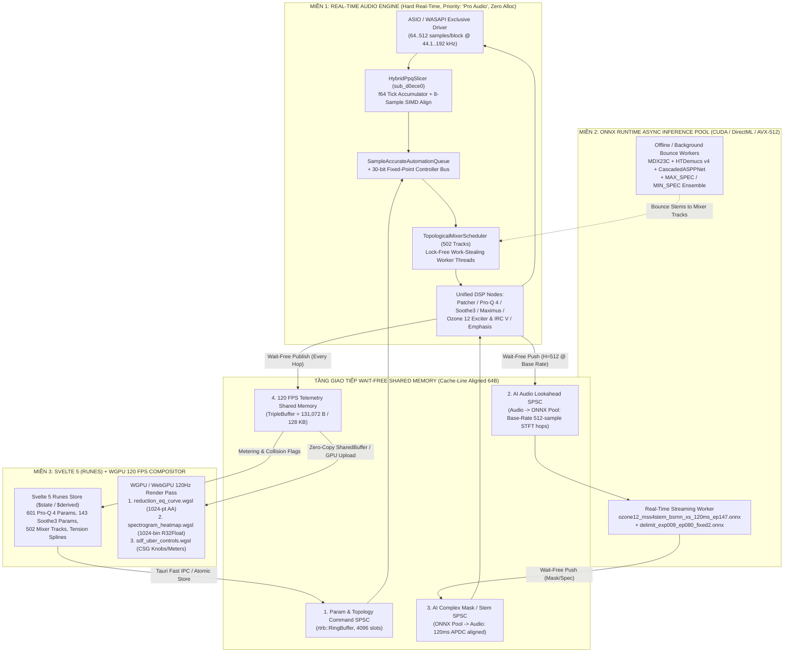

# Bước 5: Bản Quy Hoạch Kiến Trúc Tổng Thể — Master Rust + Svelte 5 + WGPU + ONNX Runtime Production Blueprint

> **Tài liệu nghiên cứu & thiết kế Clean-Room (Bước 5 / 5 — Master Production Blueprint)**  
> **Ngày thực hiện:** 2026-11-06  
> **Tổng hợp và kiểm chứng chéo từ 4 hồ sơ giải mã tĩnh Clean-Room:**  
> 1. [`01_inventory_and_unpack.md`](file:///f:/FL%20studio/research_notes/01_inventory_and_unpack.md) — Giải nén tĩnh 4 bộ cài (`FS/ISB/3`, `Inno Setup 5.5.7 Solid LZMA1`, `BitRock CookFS CFS0002`, `NSIS 64-bit 27,574 entries`) & kiểm kê nhị phân PE64.  
> 2. [`02_proq4_and_soothe3_dsp.md`](file:///f:/FL%20studio/research_notes/02_proq4_and_soothe3_dsp.md) — Giải mã DSP, RTTI/VTable, hằng số toán học và GPU Shader của **FabFilter Pro-Q 4 (`v4.13`)** & **oeksound Soothe3 (`v1.0.5`)**.  
> 3. [`03_ozone12_and_uvr5_dsp_ai.md`](file:///f:/FL%20studio/research_notes/03_ozone12_and_uvr5_dsp_ai.md) — Giải mã nhân **iZotope Ozone 12 Advanced (`v12.2.0.1951`, `iZOzone12Core.dll` 579.8 MB)**, bảng tra bóng đèn 12AX7 DK-Method `.dat`, 17 mô hình AI `.npz`/`.onnx` & **Ultimate Vocal Remover GUI v5.6 (`UVR5`)**.  
> 4. [`04_flstudio26_daw_architecture.md`](file:///f:/FL%20studio/research_notes/04_flstudio26_daw_architecture.md) — Giải mã nhân **FL Studio 26 (`v26.1.7.5654`, `FLEngine_x64.dll`)**, Lock-Free SList Level-Order Mixer DAG 502 Tracks, 5-Point APDC, Hybrid PPQ Tick/Sample Slicer, Blend2D JIT UI & 8 Native Plugins.

---

## 1. Ma Trận Tổng Hợp Tinh Hoa Kỹ Thuật Từ 5 Hệ Thống Mục Tiêu

Bảng dưới đây ánh xạ từng cơ chế cốt lõi đã được chứng minh bằng địa chỉ mã máy (VA/RVA), cấu trúc bộ nhớ và phương trình toán học từ Bước 1–4 sang kiến trúc **Pure-Rust + Tauri v2 + WGPU + ONNX Runtime + Svelte 5**:

| Hệ thống nguồn | Phát hiện kỹ thuật cốt lõi (Chứng minh từ Binary / Symbols / Code) | Crate / Module đích | Cơ chế Triển khai Clean-Room trong Rust + WGPU + Svelte 5 |
| :--- | :--- | :--- | :--- |
| **FL Studio 26** (`FLEngine_x64.dll` `0x00400000`, `QuickFontCache_x64.dll`, `ILWASAPI2ASIO_x64.dll`) | - Mảng `502` `TMixerTrack` (`0x15e06a0`, stride `0x1478 = 5,240 B`): `0`=Master, `1..500`=Inserts, `501`=Preview.<br>- Lập lịch 3 pha `sub_d0d4c0` + `TSharedThreadBank` (`0x00584720`) dùng Win32 Lock-Free `SList` work-stealing theo bậc topo (`sub_cf42f0`).<br>- **5-Point APDC** (`TBasicDelay_32FS` `0x009287a0`) + `TAutomationDelay` (`0x00c5e568`, `sub_c61630`).<br>- **Hybrid PPQ Tick/Sample Slicer** (`sub_d0ece0`) căn lề SIMD 8-sample (`0x15e1b90`) + `TMixVoiceAutomationClip` (`0x00d1ff48`) nội suy Tension Spline ra bus 30-bit fixed-point (`0x40000000`).<br>- 8 Native Plugins: `Patcher` (`TSugiyamaLayout`), `PEQ2` (`TFFTFilter`), `Maximus` (`TMEnvelope`), `Emphasis` (`ildsp_x64.dll` `Limiter` `10,496,640 B`), `Frequency Splitter`, `Fruity Limiter` (Sparse Gather/Scatter `0x6d5fe3`), `Gross Beat` (`TBRDelay_32FS`), `LuxeVerb` (`Shimmer` `1,643,632 B` FDN + PSOLA). | `crates/daw-core-graph` | - `MixerEngine` 502 tracks với bộ lập lịch DAG theo bậc topo Kahn (`TopologicalMixerScheduler`) chạy trên `crossbeam-deque` / Atomic SList work-stealing.<br>- Hệ thống bù trễ tự động 5 điểm (`ApdcDelayLine`) + hàng đợi sự kiện mẫu chính xác (`SampleAccurateAutomationQueue`).<br>- Bộ cắt lát `HybridPpqSlicer` (`f64` tick accumulator, 8-sample SIMD alignment) + `TensionSpline` (`((k*t).exp()-1)/(k.exp()-1)`).<br>- Tích hợp sẵn các node gốc không cấp phát heap lúc chạy: `PatcherGraphNode`, `MaximusMultibandNode`, `EmphasisLimiterNode`, `SparseCompressorNode`, `GrossBeatTimeBufferNode`, `LuxeVerbFdnShimmerNode`. |
| **FabFilter Pro-Q 4** (`FabFilter Pro-Q 4.clap` `0x180000000`, `DigiPageTable.xml`) | - `601` tham số (`24 Bands × 24 Params + 25 Global`).<br>- `EQFilter` (`0x180221958`): 13 kiểu lọc nội bộ (bitmask `0x10F6`), Gain-Q interaction (`0x18010FF70`), **Fractional Slope** (`0x180112260`) trộn tuyến tính 2 chuỗi cascade Biquad bậc nguyên liền kề $N_1 = \lfloor S/6 \rfloor, N_2 = N_1+1$.<br>- `NaturalPhaseFrequencyResponseSource` (`0x180221838`, trễ `0..12` mẫu, Brickwall `+320` mẫu).<br>- **Linear Phase** (`0x18019EAE0`, `0x1801A0120`): Bảng `TAP_TABLE_1X = [4096, 8192, 16384, 32768, 131072]` nhân `scale`, cửa sổ Kaiser `60.0 dB` (`0x180232D00`), **Recursive Non-Uniform Partitioned Overlap-Save Convolver** ($64 \to 512 \to 4096 \to 32768$) kèm crossfade IR chống click (`0x1801A15B0`).<br>- `Detector` (`0x180221778`) + `Capacitor` (`0x180221710`): Envelope follower RC phi tuyến phụ thuộc chương trình `f64`.<br>- **Spectral Dynamics** (`0x18019F1D0`, `0x1801A28F0`): $N_{\text{STFT}} = 2048 \times \text{scale}$, hop $512 \times \text{scale}$, trễ $1024 \times \text{scale}$ mẫu.<br>- **Character** (`Clean`/`Subtle`/`Warm` `0x18019DA1F`) & **512-bin 8-knot Perceptual Auto-Gain** (`0x18019BD20`). | `crates/dsp-proq4-eq` | - `ProQ4Processor` hỗ trợ đủ 24 bands × 24 tham số, Zero Latency, Natural Phase (complex polynomial analog matching), và Linear Phase (Non-Uniform Partitioned FFT Convolver với dual-IR crossfading).<br>- `ProgramDependentCapacitor` chạy ở độ chính xác kép `f64` điều chế $\tau_{\text{att}}, \tau_{\text{rel}}$ theo crest factor.<br>- `SpectralDynamicsCore` xử lý 4-bin SIMD `f32x4` với mặt nạ làm mượt theo `Spectral Density`.<br>- `SharedInstanceCollisionBus` phát hiện va chạm phổ giữa mọi track trong DAW. |
| **oeksound Soothe3** (`soothe3.vst3`, `soothe3_symbols.map` 142,863 dòng) | - `143` tham số (`26 Global + 72 Sidechain EQ 8-Band + 45 Atmos/Multichannel`).<br>- `dsp::Resampler<16, float, 16384>` chuẩn hóa 2x/4x sample rate về $f_{\text{base}} \in \{44.1, 48\}\text{ kHz}$ (polyphase 16-tap, trễ `96`/`192` mẫu).<br>- **8-Band Sidechain EQ**: các band `shape == 3` (`Bandpass`) được mắc **song song (parallel)** rồi nhân với chuỗi nối tiếp.<br>- Đường cong Tilt tần số quanh `500 Hz` và `2000 Hz` cho `Detail`, `Attack`, `Release`.<br>- Tách phổ chi tiết $P_{\text{det}}$ so với phổ nền ERB/Bark $\overline{P}_{\text{ref}}$ trong 2 chế độ `Soft` (Level-Independent Prominence) và `Hard` (Level-Dependent Threshold), kẹp trần `Max cut` (`-36..0 dB`).<br>- `dsp::MinimumPhaseReconstructor`: Khôi phục pha tối thiểu bằng **Real Cepstrum / Hilbert Transform** $\phi_{\min} = -\mathcal{H}\{\ln G\}$ (trễ `2,304` mẫu Regular, `3,456` mẫu Linear-Phase, `0` mẫu Low-Latency @ 1x).<br>- 6 cặp GPU Shaders (`reductionCurve`, `outline`, `renderTarget`, `shape` SDF CSG, `texture`, `gradient`). | `crates/dsp-soothe3-spectral` & `ui-svelte5-wgpu` | - `Soothe3Processor` tích hợp bộ hạ mẫu đa pha 16-tap tách dải siêu âm, 8-band Series/Parallel Sidechain EQ, bộ ước lượng đường bao nền ERB/Bark và bộ tái tạo pha tối thiểu Cepstral FFT.<br>- Hỗ trợ đầy đủ `Soft`/`Hard`, `Inverse` (Spectral Unmasking/Ducking khi có External Sidechain), `Delta` solo.<br>- Chuyển thể trực tiếp 6 cặp shader của `kali::Renderer` sang **WGSL (`wgpu`)** để vẽ đường cong cắt giảm 1,024 điểm có khử răng cưa đạo hàm màn hình `fwidth` và các nút vặn SDF CSG ở 120 FPS. |
| **iZotope Ozone 12** (`iZOzone12Core.dll` `0x180000000`, `IZRESEMBED`, `exciterCache`) | - Phân cấp `DSP::ElementImpl` (`0x1856DF158`) $\to$ `DSP::OzoneChainElement` (`0x18572E258`).<br>- **Maximizer** (`0x185767808`): Upward Compression (`LowLevelBoost`), Pre-Limiter Soft Clipper ($k_m \in \{0.85, 0.70, 0.50\}$), tách Transient/Sustain bằng cây cực đại trượt `DSP::MaxHeap` (`0x183F81EE4`), **5 chế độ IRC (IRC I–V + IRC LL)**, True-Peak 4x FIR 48-tap (`IPPCODE`) & **MBIT+ Dither** (`0x183F63430`).<br>- **Exciter 12AX7 DK-Method** (`KState<3, 2, 2, KorenFunction>` `0x181DB8BA0`): Giải mạch đèn 3 tụ điện bằng bảng tra song tuyến tính 2D `360×360` (`exciter-triode-*.dat` magic `0x8BAD43FC`, $\mu=100, k_g=1060, k_p=600, k_{vb}=300, x=1.4$).<br>- **Stem EQ & Master Rebalance**: Phương trình cộng tính bảo toàn pha $Y = X + \sum_s (\Delta H_s - 1)\hat{S}_s$ (bit-transparent khi gain $= 0\text{ dB}$).<br>- **12 mô hình `.onnx` BSRNN** (`ozone12_mss4stem_bsrnn_xs_120ms_ep147.onnx` `120 ms` real-time 4-stem, `delimit_exp009_ep080_fixed2.onnx` cho `OzoneUnlimiter`) + **3 mô hình `.npz` 2-layer GRU-512** + 2 CNN phân loại thể loại/nhạc cụ (`gparamsBN8.0.npz`, `instrument_classifier_params.npz`). | `crates/dsp-ozone12-mastering` & `crates/ai-uvr5-stem-engine` | - Chuỗi Mastering Mothership hợp nhất: `StemEqModule`, `MasterRebalanceModule`, `UnlimiterModule`, `BassControlModule`, `StabilizerModule`, `ImpactModule`, `ClarityModule`, `LowEndFocusModule`, `SpectralShaperModule`, `MultibandImagerModule`, `DkTriodeExciterModule`, `IrcMaximizerModule` (Sliding `MaxHeap` + IRC I–V + 4x True-Peak + MBIT+ Dither).<br>- Bộ đọc nhị phân chuẩn xác từng byte định dạng `.dat` (`0x8BAD43FC`) kèm bộ giải Newton-Raphson cho phương trình Norman Koren ở mọi tần số lấy mẫu. |
| **UVR5 (`v5.6`)** (`separate.py`, `tfc_tdf_v3.py`, `htdemucs.py`, `nets_new.py`, `spec_utils.py`) | - **MDX-Net (`ConvTDFNet`) & MDX23C (`TFC_TDF_net`)**: Biểu diễn CaC 4 kênh `[Re_L, Im_L, Re_R, Im_R]`, cắt bin Nyquist `x[:, :, :-1]`, nhánh TDF nhân ma trận dọc toàn trục tần số $F_s$, khử nhiễu đảo dấu 2 chiều $\frac{1}{2}(\mathcal{M}(S) - \mathcal{M}(-S))$.<br>- **Demucs v4 (`HTDemucs`)**: U-Net kép Time + Spectral khớp độ dài tại tầng 5, cổ chai `CrossTransformerEncoder` 2D sinusoidal embedding.<br>- **VR (`CascadedASPPNet`)**: Ngân hàng STFT 4 tốc độ lấy mẫu (`4band_v3.json`: `7350/14700/44100 Hz`), U-Net 3 tầng nối tiếp + ASPP + LSTM.<br>- **Ensemble & Phase Inversion**: `MAX_SPEC` / `MIN_SPEC` chọn nguyên số phức STFT $X_{i^*}(c,f,t)$, căn chỉnh sub-sample Hilbert cross-correlation và `invert_audio`. | `crates/ai-uvr5-stem-engine` | - Hỗ trợ 2 chế độ vận hành AI:<br>  1. **Real-Time Low-Latency Streaming (`120 ms` APDC)**: Chạy `BSRNN 4-stem` (`ozone12_mss4stem_bsrnn_xs_120ms_ep147.onnx`) và `Unlimiter` (`delimit_exp009_ep080_fixed2.onnx`) ngay trên Mixer Track / Master Bus thông qua worker ONNX Runtime ưu tiên cao.<br>  2. **Offline / Bounce High-Precision Stem & Ensemble Pipeline**: Chạy `MDX23C` + `HTDemucs v4` + `CascadedASPPNet` với 2-pass denoise, hợp nhất `MAX_SPEC`/`MIN_SPEC` và tách stem thẳng ra các Mixer Track của DAW. |

---

## 2. Cấu Trúc Cargo Workspace Đa Crate Chi Tiết

Toàn bộ dự án được tổ chức thành một **Cargo Workspace chuẩn Rust 2024 Edition** gồm **6 crate Rust backend/DSP/AI** và **1 gói giao diện `ui-svelte5-wgpu`**:

```text
fl-ozone-master-daw/
├── Cargo.toml                          # Workspace root: tối ưu LTO, SIMD AVX2/AVX-512, dependencies dùng chung
├── assets/
│   ├── models/
│   │   ├── bsrnn_realtime/             # ozone12_mss4stem_bsrnn_xs_120ms_ep147.onnx, delimit_exp009_ep080_fixed2.onnx
│   │   ├── npz_gru_stems/              # vocals-small_sanitized.npz, drums-small_sanitized.npz, bass-small_sanitized.npz
│   │   ├── uvr5_mdx23c/                # MDX-Net / TFC-TDF-v3 ONNX models & mdx_c_configs/*.yaml
│   │   ├── uvr5_htdemucs/              # HTDemucs v4 4-stem / 6-stem ONNX / Safetensors models
│   │   ├── uvr5_vr_aspp/               # CascadedASPPNet models & 4band_v3.json
│   │   └── assistant_cnn/              # gparamsBN8.0.npz, instrument_classifier_params.npz
│   └── exciter_luts/                   # exciter-triode-*.dat, exciter-dualtriode-*.dat (magic 0x8BAD43FC)
├── crates/
│   ├── daw-core-graph/                 # Nhân DAW FL Studio 26: 502-Track DAG, 5-Point APDC, PPQ Slicer, Patcher, Native FX
│   │   ├── Cargo.toml
│   │   └── src/
│   │       ├── lib.rs
│   │       ├── audio_io/               # ASIO & WASAPI Exclusive/Shared bridge (AvSetMmThreadCharacteristicsW("Pro Audio"))
│   │       ├── slicer_ppq.rs           # Hybrid PPQ Tick & Sample Slicer (8-sample SIMD alignment, TempoMap)
│   │       ├── mixer_dag.rs            # 502 MixerTracks, Kahn Level-Order Scheduler, Lock-Free Work-Stealing Pool
│   │       ├── apdc_engine.rs          # 5-Point ApdcDelayLine & SampleAccurateAutomationQueue (TAutomationDelay)
│   │       ├── automation_spline.rs    # TensionSpline, LFO, 30-bit Fixed-Point Internal Controller Bus (0x40000000)
│   │       ├── patcher_modular.rs      # Modular Node Graph + Sugiyama Auto-Layout + VST3/CLAP Wrapper
│   │       ├── native_fx/              # Maximus, Emphasis (10MB Limiter), Sparse FruityLimiter, GrossBeat, LuxeVerb FDN
│   │       └── telemetry_shm.rs        # Lock-Free SPSC RingBuffer & TripleBuffers (128 KB VisualTelemetryFrame)
│   │
│   ├── dsp-proq4-eq/                   # Nhân FabFilter Pro-Q 4: 24-Band Dynamic / Spectral / Linear-Phase EQ
│   │   ├── Cargo.toml
│   │   └── src/
│   │       ├── lib.rs
│   │       ├── params_601.rs           # 576 Band Params (24x24) + 25 Global Params mapping (log2 octave freq, Q)
│   │       ├── biquad_frac_slope.rs    # 13 Filter Prototypes (bitmask 0x10F6), Gain-Q interaction, Dual-Cascade Frac Slope
│   │       ├── natural_phase.rs        # s-plane Magnitude + Phase matching complex polynomial evaluator (0..12 samples)
│   │       ├── linear_phase_conv.rs    # Kaiser 60dB FIR generator + Recursive Non-Uniform Partitioned FFT Convolver
│   │       ├── dynamic_rc.rs           # Soft-Knee Detector + Double-Precision Program-Dependent Capacitor
│   │       ├── spectral_dynamics.rs    # 2048xScale STFT per-bin processor + Spectral Density smoothing kernel
│   │       ├── character_waveshaper.rs # Clean / Subtle / Warm asymmetric tube-transformer saturation LUT
│   │       └── auto_gain_512.rs        # 8-knot 512-bin perceptual loudness weighting & Cross-Instance Collision Bus
│   │
│   ├── dsp-soothe3-spectral/           # Nhân oeksound Soothe3: Dynamic Resonance Suppressor & Cepstral Min-Phase
│   │   ├── Cargo.toml
│   │   └── src/
│   │       ├── lib.rs
│   │       ├── params_143.rs           # 26 Global + 72 Sidechain EQ (8x9) + 45 Multichannel/Atmos group parameters
│   │       ├── polyphase_resampler.rs  # Resampler<16, f32, 16384>: tách dải siêu âm & chuẩn hóa 2x/4x về 44.1/48 kHz
│   │       ├── sidechain_eq_8band.rs   # 8-Band SVF/Biquad: Series cascade + Parallel Bandpass (shape == 3) routing
│   │       ├── tilt_curves.rs          # Smooth shelf transitions quanh 500 Hz (low) & 2000 Hz (high) cho Detail/Att/Rel
│   │       ├── resonance_detector.rs   # ERB/Bark baseline estimator, Soft (prominence) vs Hard (abs+prominence) mode
│   │       └── cepstral_min_phase.rs   # Real Cepstrum / Hilbert Transform phi_min = -H{ln G} (2304 / 3456 / 0 samples)
│   │
│   ├── dsp-ozone12-mastering/          # Nhân iZotope Ozone 12: IRC I-V Maximizer, 12AX7 DK-Triode Exciter & Modules
│   │   ├── Cargo.toml
│   │   └── src/
│   │       ├── lib.rs
│   │       ├── chain_element.rs        # Trait OzoneDspModule (tương đương DSP::ElementImpl & DSP::OzoneChainElement)
│   │       ├── irc_maximizer.rs        # UpwardComp, SoftClip, MaxHeap Transient/Sustain Split, IRC I-V, 4x TruePeak, MBIT+
│   │       ├── dk_triode_exciter.rs    # KState<3,2,2,KorenFunction> parser (.dat 0x8BAD43FC) + 360x360 bilinear solver
│   │       ├── stem_eq_rebalance.rs    # Unity-Identity Additive Stem EQ & Master Rebalance (bit-transparent @ 0 dB)
│   │       ├── spectral_modules.rs     # Stabilizer, Clarity (ISO 226 unmasking), Low End Focus, Spectral Shaper
│   │       ├── multiband_imager.rs     # 4-Band Linkwitz-Riley M/S Width, Velvet-Noise Stereoizer I/II & Recover Sides
│   │       └── dynamics_impact_bass.rs # Impact 4-Band Microdynamics, Bass Control (Sustain/Punch) & Unlimiter bridge
│   │
│   ├── ai-uvr5-stem-engine/            # Nhân AI ONNX Runtime & Pure-Rust GRU: Real-Time BSRNN + Offline UVR5 Ensemble
│   │   ├── Cargo.toml
│   │   └── src/
│   │       ├── lib.rs
│   │       ├── ort_worker_pool.rs      # Lock-Free Async Inference Pool (CUDA / DirectML / CoreML / AVX-512 EP)
│   │       ├── bsrnn_streaming.rs      # Real-time 120ms 4-stem BSRNN (input_states [2,2,2,1,13,128]) & Delimiter
│   │       ├── npz_gru_legacy.rs       # Pure-Rust SIMD 2-layer GRU-512 reader cho vocals/drums/bass-small_sanitized.npz
│   │       ├── assistant_cnn_npz.rs    # Genre & Instrument CNN classifier (gparamsBN8.0.npz, instrument_classifier_params.npz)
│   │       ├── uvr5_mdx_tfctdf.rs      # MDX-Net & MDX23C (CaC 4-ch, Nyquist trim, 2-pass phase-inverted denoise)
│   │       ├── uvr5_htdemucs.rs        # Hybrid Transformer Demucs v4 (Time + Spectral U-Net + Cross-Transformer)
│   │       ├── uvr5_vr_aspp.rs         # Multi-rate 4-band STFT combiner + 3-stage CascadedASPPNet
│   │       └── spectral_ensemble.rs    # MAX_SPEC, MIN_SPEC, AVERAGE + Hilbert sub-sample alignment + invert_audio
│   │
│   └── daw-tauri-host/                 # Ứng dụng Tauri v2 Desktop Host: Quản lý cửa sổ, IPC Commands, Shared Memory
│       ├── Cargo.toml
│       ├── tauri.conf.json
│       └── src/
│           ├── main.rs
│           ├── ipc_commands.rs         # Tauri commands điều khiển Transport, Graph routing, Preset IO, Stem Bounce
│           ├── wgpu_compositor.rs      # Native WGPU surface / WebGPU shared texture bridge 120 FPS
│           └── shm_telemetry_server.rs # Cấp phát bộ nhớ chia sẻ / Custom Protocol stream zero-copy sang WebView2
│
└── ui-svelte5-wgpu/                    # Giao diện Svelte 5 (Runes $state/$derived) + WGPU/WebGPU WGSL Shaders 120 FPS
    ├── package.json
    ├── vite.config.ts
    └── src/
        ├── lib/
        │   ├── state/
        │   │   └── daw_master_store.svelte.ts  # Svelte 5 Runes ($state/$derived) cho Transport, 502 Tracks, Pro-Q 4, Soothe3, Ozone 12
        │   ├── wgpu/
        │   │   ├── renderer_120fps.ts          # Vòng lặp WebGPU 120Hz đọc VisualTelemetryFrame (131,072 B) zero-copy
        │   │   └── shaders/
        │   │       ├── reduction_eq_curve.wgsl # Chuyển thể từ Soothe3 reductionCurve & Pro-Q 4 analytical AA strip
        │   │       ├── spectrogram_heatmap.wgsl# Heatmap 2D cho Fruity PEQ2 / Soothe3 / Ozone Spectral Shaper
        │   │       └── sdf_uber_controls.wgsl  # Chuyển thể từ Soothe3 shapeFragmentShader (CSG 7 SDF primitives)
        │   └── components/
        │       ├── MixerRack502.svelte
        │       ├── PatcherNodeCanvas.svelte
        │       ├── ProQ4InteractiveAnalyzer.svelte
        │       ├── Soothe3ResonanceView.svelte
        │       ├── Ozone12MasterChain.svelte
        │       └── Uvr5EnsembleStudio.svelte
        └── App.svelte
```

### Cấu hình `Cargo.toml` Gốc của Workspace

```toml
[workspace]
resolver = "2"
members = [
    "crates/daw-core-graph",
    "crates/dsp-proq4-eq",
    "crates/dsp-soothe3-spectral",
    "crates/dsp-ozone12-mastering",
    "crates/ai-uvr5-stem-engine",
    "crates/daw-tauri-host",
]

[workspace.package]
version = "0.1.0"
edition = "2024"
authors = ["Clean-Room Audio Engineering Team"]
license = "Proprietary"

[workspace.dependencies]
# Real-time lock-free concurrency & SIMD
crossbeam-deque = "0.8"
crossbeam-utils = "0.8"
rtrb = "0.3"                   # Wait-free Single-Producer Single-Consumer RingBuffer
triple_buffer = "8.0"          # Wait-free Triple Buffer cho UI Frame Snapshots (128 KB)
parking_lot = "0.12"
wide = "0.7"                   # Portable SIMD f32x4 / f32x8 / f64x2 / f64x4
bytemuck = { version = "1.18", features = ["derive", "min_const_generics"] }

# FFT, Resampling & Audio I/O
realfft = "3.4"
rustfft = "6.2"
rubato = "0.16"
cpal = { version = "0.15", features = ["asio"] }
windows = { version = "0.58", features = [
    "Win32_Media_Audio",
    "Win32_System_Threading",
    "Win32_System_Com",
] }

# AI Inference & Array Serialization (.onnx & .npz)
ort = { version = "2.0.0-rc.9", features = ["cuda", "directml", "load-dynamic"] }
ndarray = "0.16"
ndarray-npy = { version = "0.9", features = ["npz"] }
serde = { version = "1.0", features = ["derive"] }
serde_json = "1.0"

# Graphics & Desktop Host
wgpu = "23.0"
tauri = { version = "2.1", features = ["protocol-asset"] }

[profile.release]
opt-level = 3
lto = "fat"
codegen-units = 1
panic = "abort"
strip = false
```

---

## 3. Kiến Trúc Lock-Free IPC & Shared-Memory RingBuffer (Audio Thread $\leftrightarrow$ ONNX Pool $\leftrightarrow$ 120 FPS UI)

Để đảm bảo **luồng âm thanh thời gian thực (Real-Time Audio Thread)** không bao giờ bị chặn (zero mutex contention, zero heap allocation, zero system call sau khi khởi tạo) trong khi vẫn chạy suy luận **ONNX Runtime (`120 ms` BSRNN)** và dựng hình **Svelte 5 + WGPU ở 120 FPS**, hệ thống áp dụng kiến trúc **3 miền thực thi cách ly hoàn toàn qua bộ nhớ chia sẻ không khóa (Wait-Free Shared-Memory Channels)**:



### 3.1. Cơ Chế Đồng Bộ Thời Gian Thực Giữa Audio Thread và ONNX Runtime (`120 ms` BSRNN Streaming & Dual-Band Ultrasonic Bypass)

Từ Bước 3 (Mục 4.2) và Bước 1 (Mục 3.3.B), mô hình `models/ozone12_mss4stem_bsrnn_xs_120ms_ep147.onnx` nhận cửa sổ trượt `3` khung STFT ($N_{\text{FFT}} = 2048, H = 512$, `1,025` bins chia thành `13` subbands ở tần số lấy mẫu cơ sở $f_{\text{base}} \in \{44.1, 48\}\text{ kHz}$) với độ trễ thiết kế đúng **`120 ms`** ($5,760$ mẫu ở $48\text{ kHz}$, $5,292$ mẫu ở $44.1\text{ kHz}$, hoặc $11,520$ mẫu ở $96\text{ kHz}$):
1. **Báo cáo APDC cố định**: Khi bật `OzoneStemEQ`, `MasterRebalance` hoặc `Unlimiter` ở chế độ Real-Time trên một Mixer Track, node báo cáo `latency_samples() = (0.120 * sample_rate).round() as usize` cho `TopologicalMixerScheduler`. Hệ thống **5-Point APDC** lập tức bù trễ tất cả các track song song và nhánh Dry (`Point 3` & `Point 5`).
2. **Chuẩn hóa Tốc độ Lấy mẫu Tách Dải (`BaseRateResampler` — kế thừa `iZResampler::ResamplerEngine` & `dsp::Resampler<16, float, 16384>`)**:
   - Nếu DAW chạy ở $2\times$ ($88.2/96\text{ kHz}$) hoặc $4\times$ ($176.4/192\text{ kHz}$), tín hiệu đầu vào đi qua bộ lọc đa pha 16-tap hạ mẫu về $f_{\text{base}} \in \{44.1, 48\}\text{ kHz}$ trước khi tính STFT $N_{\text{FFT}} = 2048, H = 512$. Điều này đảm bảo trục tần số `1,025` bins của BSRNN và GRU `.npz` luôn giữ đúng vị trí 13 subbands.
3. **Đường ống trượt không khóa (Wait-Free Sliding STFT Pipe)**:
   - Mỗi khi bộ đệm tại $f_{\text{base}}$ tích lũy đủ 1 bước nhảy $H = 512$ mẫu ($\approx 10.67\text{ ms}$ @ 48 kHz), Audio Thread thực hiện FFT $2048$ điểm (`realfft` SIMD mất $< 15\,\mu\text{s}$), đẩy khung phổ phức `Complex32[1025]` của 2 kênh L/R vào `AiInRB` (`rtrb::Producer`) và đánh thức luồng ONNX Worker bằng `WakeByAddressSingle` (hoàn toàn không khóa Audio Thread).
   - Luồng **ONNX Streaming Worker** rút khung phổ mới ra, ghép vào tensor trượt `input_spectrogram: f32[2, 1, 1025, 3, 2]` cùng trạng thái đệ quy `input_states: f32[2, 2, 2, 1, 13, 128]`, chạy `session.run()` trên GPU (CUDA / DirectML mất $\approx 1.8\text{–}3.5\text{ ms}$ cho mỗi bước nhảy $10.67\text{ ms}$) và đẩy kết quả `output_spectrogram: f32[2, 3, 1, 1025, 1, 2]` (3 stems: Vocals, Drums, Bass) vào `AiOutRB`.
   - Tại đầu ra của đường trễ `120 ms` trên Audio Thread, khung phổ stem đã nằm sẵn trong `AiOutRB`. Audio Thread chỉ tính **phần hiệu số cộng bù**:
     $$\Delta Y_{\text{base}}(f, t) = \sum_{s \in \{\text{voc, drm, bas, oth}\}} \left(\Delta H_s(f) - 1\right)\hat{S}_s(f, t)$$
     thực hiện IFFT + Overlap-Add (và nâng mẫu lên $2\times/4\times$ nếu DAW chạy ở $96/192\text{ kHz}$), rồi cộng trực tiếp vào tín hiệu gốc đã trễ $x_{\text{delayed}}[n]$. Nhờ công thức cộng bù này:
     * Khi mọi band EQ của cả 4 stem bằng `0 dB` ($\Delta H_s(f) \equiv 1$), $\Delta Y_{\text{base}} \equiv 0 \implies y[n] \equiv x_{\text{delayed}}[n]$ (**bit-transparent tuyệt đối**, giữ nguyên cả dải siêu âm $> 24\text{ kHz}$!).
     * Nếu GPU đột ngột bận ở một khung hiếm hoi, Audio Thread có thể dùng lại mặt nạ tỷ số của khung liền trước ($\hat{M}_{t-1}$) mà **không bao giờ gây xrun/dropout**.

### 3.2. Giao Thức Bố Cục Bộ Nhớ Telemetry 120 FPS (`VisualTelemetryFrame` — Chuẩn Xác Từng Byte `131,072 B = 128 KB`)

Để đạt tốc độ vẽ **120 FPS** ($\approx 8.33\text{ ms/frame}$) cho đồng thời phổ Pre/Post/Sidechain FFT của Pro-Q 4, đường cong cắt giảm 1,024 điểm của Soothe3, Heatmap 2D của PEQ2/Soothe3, và đồng hồ Peak/RMS/LUFS/Gain-Reduction của 502 Mixer Tracks mà không gây nghẽn IPC của Tauri, Backend Rust duy trì cấu trúc `#[repr(C, align(64))] pub struct VisualTelemetryFrame` có kích thước cố định chính xác **`131,072` bytes (`0x20000 B = 128 KB`)** trong `TripleBuffer<VisualTelemetryFrame>`:

| Offset (Hex) | Kích thước (Bytes) | Trường dữ liệu (`#[repr(C)]`) | Tần suất cập nhật & Mục đích sử dụng trên WGPU / Svelte 5 |
| :--- | ---: | :--- | :--- |
| `0x00000..0x0003F` | `64 B` (`0x0040`) | `TransportAndMasterHeader` (`frame_seq: u64`, `sample_pos: i64`, `ppq_tick: i64`, `bpm: f32`, `cpu_load_pct: f32`, `lufs_momentary: f32`, `lufs_short_term: f32`, `lufs_integrated: f32`, `true_peak_db: [f32; 2]`, `master_gr_db: f32`, `active_stem_mode: u32`, `reserved: [u32; 1]`) | Cập nhật mỗi sub-block; hiển thị thanh Transport, đồng hồ LUFS/True-Peak chuẩn ITU-R BS.1770-4. |
| `0x00040..0x02F4F` | `12,048 B` (`0x2F10`) | `TrackMeterEntry[502]` (`502 × 24 B`: `peak_l_db: f32`, `peak_r_db: f32`, `rms_l_db: f32`, `rms_r_db: f32`, `gr_db: f32`, `activity_flags: u32`) | Cập nhật toàn bộ 502 Mixer Tracks (`Master`, `1..500`, `Preview`) ở 120 FPS. |
| `0x02F50..0x02FFF` | `176 B` (`0x00B0`) | `HeaderAlignPad` (`[u8; 176]`) | Căn chỉnh ranh giới `0x03000` (bội số `4,096 B`) cho GPU `writeBuffer` zero-copy. |
| `0x03000..0x06FFF` | `16,384 B` (`0x4000`) | `ProQ4SpectrumFrame` (`pre_db: [f32; 1024]`, `post_db: [f32; 1024]`, `sc_db: [f32; 1024]`, `collision_mask: [f32; 1024]`) | Nạp thẳng vào GPU Buffer để vẽ phổ FFT nghiêng `4.5 dB/oct` và vùng đỏ va chạm phổ (`Show Collisions`). |
| `0x07000..0x08FFF` | `8,192 B` (`0x2000`) | `Soothe3ReductionFrame` (`reduction_ys: [[f32; 4]; 256]` = 1,024 floats + `input_spec_db: [f32; 1024]`) | Khớp chính xác byte-by-byte với mảng `float4 ys[256]` của `reductionCurveFragmentShader` trong `soothe3.vst3`. |
| `0x09000..0x0AFFF` | `8,192 B` (`0x2000`) | `Ozone12MasterTelemetry` (`irc_gr_trace: [f32; 512]`, `polar_sample_xy: [[f32; 2]; 512]`, `tonal_balance_bars: [f32; 256]`, `stem_rms_db: [f32; 4]`, `imager_corr_bands: [f32; 4]`, `exciter_drive_gr: [f32; 248]`) | Dựng đồ thị cuộn Gain Reduction của IRC V, Vectorscope XY, Tonal Balance và đồng hồ 4 Stems. |
| `0x0B000..0x1EFFF` | `81,920 B` (`0x14000`) | `ScrollingSpectrogramRing` (`lines: [[f32; 1024]; 20]`) | Bộ đệm vòng 20 dòng thác phổ `1,024` bins độ phân giải cao cho Heatmap 2D của `PEQ2`, `Soothe3` và `Ozone Spectral Shaper`. |
| `0x1F000..0x1FFFF` | `4,096 B` (`0x1000`) | `AutomationAndSplineTelemetry` (`controller_values_norm: [f32; 512]`, `gross_beat_playhead_pos: [f32; 2]`, `patcher_node_cpu_pct: [f32; 510]`) | Hiển thị vị trí con chạy thực thời trên `TensionSpline`, `Gross Beat` 36-slot và tải CPU từng node trong `Patcher`. |
| **Tổng cộng** | **`131,072 B`** (`0x20000`) | **`VisualTelemetryFrame`** (`128.0 KB` cố định, căn lề 64-byte) | **Zero heap allocation, trao đổi nguyên khối qua `TripleBuffer` ở 120 Hz.** |

---

## 4. Hợp Nhất Chuỗi Xử Lý Tín Hiệu (Unified Master Signal Flow)

Sơ đồ dưới đây thể hiện cách các thuật toán từ cả 5 phần mềm được hợp nhất thành một chuỗi xử lý liền mạch từ **Generator / Stem Input $\to$ Insert Track FX Rack $\to$ Modular Patcher $\to$ Master AI & Mastering Bus**:

```mermaid
flowchart LR
    subgraph InputStage["1. Nguồn Âm & Tách Stem"]
        Gen["Generators / Audio Clips<br/>+ Point 1 APDC"]
        HWIn["ASIO / WASAPI Input<br/>+ Point 2 APDC"]
        UVROffline["UVR5 Offline Studio<br/>(MDX23C + HTDemucs v4 + VR ASPP<br/>+ MAX/MIN_SPEC Ensemble)"]
        UVROffline -->|"Tách thành 4-6 Track riêng"| TrackIn
        Gen --> TrackIn["Mixer Track Input<br/>(Track 1..500)"]
        HWIn --> TrackIn
    end

    subgraph TrackRack["2. Chuỗi 10 FX Slots Trên Mỗi Mixer Track (Kèm Point 3 Dry/Wet APDC)"]
        TrackIn --> SlotProQ["Slot A: dsp-proq4-eq<br/>(24-Band Zero/Natural/Linear Phase<br/>+ Capacitor Dynamic EQ + Spectral)"]
        SlotProQ --> SlotSoothe["Slot B: dsp-soothe3-spectral<br/>(8-Band Series/Parallel SC EQ<br/>+ Soft/Hard Prominence + Cepstral Min-Phase)"]
        SlotSoothe --> SlotFL["Slot C: Native FL Studio 26 FX<br/>(Patcher DAG / Gross Beat /<br/>Sparse Fruity Limiter / LuxeVerb FDN)"]
        SlotFL --> PostAPDC["Point 4 Post-Rack APDC<br/>+ Point 5 Inter-Track Send APDC"]
    end

    subgraph MasterBus["3. Master Bus (Track 0): Chuỗi AI Mastering Hợp Nhất (Ozone 12 + FL Emphasis)"]
        PostAPDC --> StemEQ["1. BSRNN 120ms Real-Time<br/>Master Rebalance & 4-Stem EQ<br/>(Unity-Identity Additive Mixing)"]
        StemEQ --> Unlim["2. AI Unlimiter (delimit ONNX)<br/>+ Bass Control (Sustain/Punch)"]
        Unlim --> StabClar["3. Stabilizer (Bark Target)<br/>+ Low End Focus + Clarity (ISO 226)"]
        StabClar --> ExcImager["4. 4-Band 12AX7 DK-Triode Exciter<br/>(360x360 Koren LUT) + 4-Band Imager<br/>(Velvet Stereoizer + Recover Sides)"]
        ExcImager --> MaxFinal["5. IRC V / Emphasis Final Limiter<br/>(UpwardComp + SoftClip + MaxHeap Split<br/>+ 4x 48-Tap True-Peak + MBIT+ Dither)"]
    end
```



---

## 5. Mã Nguồn Khung Cấp Độ Production (Rust Traits/Structs, WGSL Shaders & Svelte 5 State)

### 5.1. Nhân Đồ Thị DAW, 5-Point APDC, PPQ Slicer, Sparse Dynamics & Telemetry 128 KB (`crates/daw-core-graph/src/lib.rs`)

```rust
//! `daw-core-graph`: Production-grade Core Audio Graph, 5-Point APDC, Hybrid PPQ Slicer,
//! Tension Spline Evaluator, Zero-Allocation Sparse Dynamics, and 128 KB Lock-Free Telemetry.

use std::sync::atomic::AtomicU32;
use std::sync::Mutex;

pub const MAX_MIXER_TRACKS: usize = 502; // 0 = Master, 1..=500 = Inserts, 501 = Preview
pub const MAX_INSERT_SLOTS: usize = 10;
pub const MAX_BLOCK_SIZE: usize = 4096;
pub const FIXED_POINT_30BIT_SCALE: f64 = 1_073_741_824.0; // 0x40000000 (`sub_d24d80`)

pub type StereoFrame = [f32; 2];

/// Ngữ cảnh thời gian thực truyền vào mọi Node DSP trong mỗi lát cắt PPQ (`sub_d0ece0`).
#[derive(Clone, Copy, Debug)]
pub struct ProcessContext {
    pub sample_rate: f64,
    pub current_sample_pos: i64,
    pub ppq_tick: i64,
    pub bpm: f64,
    pub slice_frames: usize,
    pub is_playing: bool,
    pub is_offline_rendering: bool,
}

/// Trait thống nhất kết hợp `TFruityPlug` (`04_flstudio26`), `ProQProcessor` (`02_proq4`),
/// `dsp::MainProcessor` (`02_soothe3`) và `DSP::OzoneChainElement` (`03_ozone12`).
pub trait UnifiedDspNode: Send {
    fn name(&self) -> &'static str;

    /// Độ trễ nội tại tính bằng mẫu tại `sample_rate` hiện tại (phục vụ 5-Point APDC).
    fn latency_samples(&self) -> usize;

    /// Cấp phát trước toàn bộ bộ đệm khi đổi tần số lấy mẫu / kích thước khối.
    /// CẤM cấp phát bộ nhớ heap trong `process_slice`.
    fn prepare(&mut self, sample_rate: f64, max_block_size: usize);

    /// Xóa trạng thái đường trễ / bộ lọc IIR / FFT overlap khi dừng phát hoặc nhảy vị trí.
    fn reset_state(&mut self);

    /// Cập nhật tham số mẫu chính xác (nhận giá trị chuẩn hóa `0.0..=1.0` hoặc từ `TAutomationDelay`).
    fn set_parameter_normalized(&mut self, param_id: u32, norm_val: f32);

    /// Được gọi tại ranh giới xung nhịp PPQ Tick (`TFruityPlug::NewTick` `vfn[14]`).
    fn on_ppq_tick(&mut self, _ctx: &ProcessContext) {}

    /// Xử lý lát cắt âm thanh thời gian thực (Zero Heap Allocation).
    fn process_slice(
        &mut self,
        ctx: &ProcessContext,
        main_io: &mut [StereoFrame],
        sidechain_in: Option<&[StereoFrame]>,
        aux_sends_out: &mut [&mut [StereoFrame]],
    );
}

/// Đường trễ bù pha mẫu chính xác (`TBasicDelay_32FS` `VMT = 0x009287a0` trong `FLEngine_x64.dll`).
pub struct ApdcDelayLine {
    ring: Vec<StereoFrame>,
    cursor: usize,
    delay_samples: usize,
}

impl ApdcDelayLine {
    pub fn with_capacity(max_delay_samples: usize) -> Self {
        Self {
            ring: vec![[0.0; 2]; max_delay_samples.max(1)],
            cursor: 0,
            delay_samples: 0,
        }
    }

    #[inline]
    pub fn set_delay_samples(&mut self, delay_samples: usize) {
        assert!(delay_samples <= self.ring.len());
        if self.delay_samples != delay_samples {
            self.delay_samples = delay_samples;
            self.cursor = 0;
            self.ring[..delay_samples.max(1)].fill([0.0; 2]);
        }
    }

    #[inline(always)]
    pub fn process_in_place(&mut self, buf: &mut [StereoFrame]) {
        let d = self.delay_samples;
        if d == 0 {
            return;
        }
        let mut c = self.cursor;
        for frame in buf.iter_mut() {
            let delayed = self.ring[c];
            self.ring[c] = *frame;
            *frame = delayed;
            c += 1;
            if c >= d {
                c = 0;
            }
        }
        self.cursor = c;
    }
}

/// 1 trong 10 FX Slots trên `TMixerTrack` (`+0x134c`), tích hợp Point 3 Dry/Wet Parallel APDC
/// (`TPluginRackModule` `0x00cf26e0`), sử dụng bộ đệm cấp phát trước (Zero-Alloc).
pub struct PluginRackSlot {
    pub plugin: Box<dyn UnifiedDspNode>,
    pub enabled: bool,
    pub wet_mix: f32,
    pub dry_apdc_delay: ApdcDelayLine, // Point 3: `[TPluginRackModule + 0x10]` (`0x00cf2c60`)
    pub dry_scratch: Vec<StereoFrame>, // Cấp phát 1 lần trong `prepare()`
}

impl PluginRackSlot {
    pub fn process(&mut self, ctx: &ProcessContext, track_buf: &mut [StereoFrame]) {
        if !self.enabled || self.wet_mix <= 0.0 {
            return;
        }
        let n = track_buf.len();
        let lat = self.plugin.latency_samples();
        self.dry_apdc_delay.set_delay_samples(lat);

        if (self.wet_mix - 1.0).abs() > 1e-6 {
            let dry = &mut self.dry_scratch[..n];
            dry.copy_from_slice(track_buf);
            self.dry_apdc_delay.process_in_place(dry);
            self.plugin.process_slice(ctx, track_buf, None, &mut []);
            let w = self.wet_mix;
            let inv_w = 1.0 - w;
            for i in 0..n {
                track_buf[i][0] = dry[i][0] * inv_w + track_buf[i][0] * w;
                track_buf[i][1] = dry[i][1] * inv_w + track_buf[i][1] * w;
            }
        } else {
            self.plugin.process_slice(ctx, track_buf, None, &mut []);
        }
    }
}

/// Tối ưu hóa Sparse Above-Threshold Log-Domain Compressor từ `Fruity Limiter_x64.dll` (`0x006d5d60`)
/// chạy hoàn toàn trên mảng stack cố định (Zero Heap Allocation).
#[inline]
pub fn sparse_compressor_gain_reduction_rt(
    envelope: &[f32],
    gain_out: &mut [f32],
    threshold_linear: f32,
    ratio_inv_minus_one: f32,
    makeup_gain: f32,
) {
    debug_assert!(envelope.len() <= MAX_BLOCK_SIZE);
    let mut active_values = [0.0f32; MAX_BLOCK_SIZE];
    let mut active_indices = [0u16; MAX_BLOCK_SIZE];
    let mut count = 0usize;

    for (idx, &env) in envelope.iter().enumerate() {
        if env > threshold_linear {
            active_values[count] = env;
            active_indices[count] = idx as u16;
            count += 1;
        }
        gain_out[idx] = makeup_gain;
    }
    if count == 0 {
        return;
    }
    let thresh_log2 = threshold_linear.log2();
    for k in 0..count {
        let over_log2 = active_values[k].log2() - thresh_log2;
        let gr_linear = (over_log2 * ratio_inv_minus_one).exp2();
        gain_out[active_indices[k] as usize] = gr_linear * makeup_gain;
    }
}

// ============================================================================
// CẤU TRÚC BỘ NHỚ TELEMETRY 120 FPS (`131,072 BYTES = 128 KB` CHÍNH XÁC TỪNG BYTE)
// ============================================================================

#[repr(C)]
#[derive(Clone, Copy, Debug)]
pub struct TransportAndMasterHeader {
    pub frame_seq: u64,          // 0x0000
    pub sample_pos: i64,         // 0x0008
    pub ppq_tick: i64,           // 0x0010
    pub bpm: f32,                // 0x0018
    pub cpu_load_pct: f32,       // 0x001C
    pub lufs_momentary: f32,     // 0x0020
    pub lufs_short_term: f32,    // 0x0024
    pub lufs_integrated: f32,    // 0x0028
    pub true_peak_db: [f32; 2],  // 0x002C..0x0033
    pub master_gr_db: f32,       // 0x0034
    pub active_stem_mode: u32,   // 0x0038
    pub reserved: [u32; 1],      // 0x003C..0x003F (Tổng = 64 B)
}

#[repr(C)]
#[derive(Clone, Copy, Debug)]
pub struct TrackMeterEntry {
    pub peak_l_db: f32,          // +0x00
    pub peak_r_db: f32,          // +0x04
    pub rms_l_db: f32,           // +0x08
    pub rms_r_db: f32,           // +0x0C
    pub gr_db: f32,              // +0x10
    pub activity_flags: u32,     // +0x14 (Tổng = 24 B)
}

#[repr(C)]
#[derive(Clone, Copy)]
pub struct ProQ4SpectrumFrame {
    pub pre_db: [f32; 1024],         // 4,096 B
    pub post_db: [f32; 1024],        // 4,096 B
    pub sc_db: [f32; 1024],          // 4,096 B
    pub collision_mask: [f32; 1024], // 4,096 B (Tổng = 16,384 B)
}

#[repr(C)]
#[derive(Clone, Copy)]
pub struct Soothe3ReductionFrame {
    pub reduction_ys: [[f32; 4]; 256], // 4,096 B (1,024 bins đóng gói vec4<f32>[256])
    pub input_spec_db: [f32; 1024],    // 4,096 B (Tổng = 8,192 B)
}

#[repr(C)]
#[derive(Clone, Copy)]
pub struct Ozone12MasterTelemetry {
    pub irc_gr_trace: [f32; 512],         // 2,048 B
    pub polar_sample_xy: [[f32; 2]; 512], // 4,096 B
    pub tonal_balance_bars: [f32; 256],   // 1,024 B
    pub stem_rms_db: [f32; 4],            // 16 B ([Vocals, Drums, Bass, Other])
    pub imager_corr_bands: [f32; 4],      // 16 B
    pub exciter_drive_gr: [f32; 248],     // 992 B (Tổng = 8,192 B)
}

#[repr(C)]
#[derive(Clone, Copy)]
pub struct AutomationAndSplineTelemetry {
    pub controller_values_norm: [f32; 512], // 2,048 B
    pub gross_beat_playhead_pos: [f32; 2],  // 8 B ([TimeSlotPos, VolSlotPos])
    pub patcher_node_cpu_pct: [f32; 510],   // 2,040 B (Tổng = 4,096 B)
}

#[repr(C, align(64))]
#[derive(Clone, Copy)]
pub struct VisualTelemetryFrame {
    pub header: TransportAndMasterHeader,                // 0x00000..0x0003F (64 B)
    pub track_meters: [TrackMeterEntry; 502],            // 0x00040..0x02F4F (12,048 B)
    pub header_align_pad: [u8; 176],                     // 0x02F50..0x02FFF (176 B)
    pub proq4_spectrum: ProQ4SpectrumFrame,              // 0x03000..0x06FFF (16,384 B)
    pub soothe3_reduction: Soothe3ReductionFrame,        // 0x07000..0x08FFF (8,192 B)
    pub ozone12_telemetry: Ozone12MasterTelemetry,       // 0x09000..0x0AFFF (8,192 B)
    pub spectrogram_ring: [[f32; 1024]; 20],             // 0x0B000..0x1EFFF (81,920 B)
    pub automation_spline: AutomationAndSplineTelemetry, // 0x1F000..0x1FFFF (4,096 B)
}

// Kiểm chứng tại thời điểm biên dịch: đảm bảo kích thước chuẩn xác 131,072 bytes (128 KB).
const _: () = assert!(std::mem::size_of::<VisualTelemetryFrame>() == 131_072);
```

---

### 5.2. Nhân FabFilter Pro-Q 4 (`crates/dsp-proq4-eq/src/lib.rs`)

```rust
//! `dsp-proq4-eq`: 24-Band Dynamic/Spectral/Linear-Phase Equalizer.
//! Implements Fractional-Slope Dual Biquad Cascade (`0x180112260`), Gain-Q Interaction (`0x18010FF70`),
//! Program-Dependent Capacitor (`0x18010A9B0`), Kaiser-60dB Non-Uniform Convolver (`0x1801A0120`),
//! and 8-Knot 512-Bin Perceptual Auto-Gain (`0x18019BD20`).

#[derive(Clone, Copy, Debug)]
pub struct FractionalSlopeBiquadBand {
    pub cascade_n1: [[f64; 5]; 8], // Bậc nguyên dưới N1 = floor(S / 6.0) (`rbx + 0xFB0`)
    pub cascade_n2: [[f64; 5]; 8], // Bậc nguyên trên N2 = N1 + 1 (`rbx + 0x10F0`)
    pub z_n1: [[[f64; 2]; 8]; 2],  // Trạng thái DF-II Transposed [ch][sec][z1, z2]
    pub z_n2: [[[f64; 2]; 8]; 2],
    pub sections_n1: usize,
    pub sections_n2: usize,
    pub alpha_frac: f64,           // Phần lẻ độ dốc frac(S / 6.0) in [0.0, 1.0)
}

impl FractionalSlopeBiquadBand {
    /// Tương tác Gain-Q kiểu bàn trộn analog (`0x18010FF70`, bitmask `0x1074`):
    #[inline]
    pub fn compute_effective_q(q_ui: f64, gain_db: f64, gain_q_interaction: bool) -> f64 {
        let q_internal = 0.7071067811865475 * q_ui;
        if !gain_q_interaction {
            return q_internal;
        }
        let clamped_db = gain_db.abs().min(12.0);
        q_internal * 1.0905077326652577f64.powf(clamped_db * 0.25)
    }

    #[inline(always)]
    pub fn process_sample(&mut self, ch: usize, x: f64) -> f64 {
        let mut y1 = x;
        for s in 0..self.sections_n1 {
            let [b0, b1, b2, a1, a2] = self.cascade_n1[s];
            let [z1, z2] = self.z_n1[ch][s];
            let out = b0 * y1 + z1;
            self.z_n1[ch][s][0] = b1 * y1 - a1 * out + z2;
            self.z_n1[ch][s][1] = b2 * y1 - a2 * out;
            y1 = out;
        }
        if self.alpha_frac <= 1e-6 {
            return y1;
        }
        let mut y2 = x;
        for s in 0..self.sections_n2 {
            let [b0, b1, b2, a1, a2] = self.cascade_n2[s];
            let [z1, z2] = self.z_n2[ch][s];
            let out = b0 * y2 + z1;
            self.z_n2[ch][s][0] = b1 * y2 - a1 * out + z2;
            self.z_n2[ch][s][1] = b2 * y2 - a2 * out;
            y2 = out;
        }
        (1.0 - self.alpha_frac) * y1 + self.alpha_frac * y2
    }
}

/// Hàm Bessel biến đổi loại 1 bậc 0 (`0x180102A10`) tạo cửa sổ Kaiser 60.0 dB (`0x180232D00`)
/// cho chế độ Linear Phase (`TAP_TABLE_1X = [4096, 8192, 16384, 32768, 131072]`).
#[inline]
pub fn bessel_i0(x: f64) -> f64 {
    let mut sum = 1.0f64;
    let mut term = 1.0f64;
    let half_x_sq = 0.25 * x * x;
    for k in 1..=25 {
        term *= half_x_sq / ((k * k) as f64);
        sum += term;
        if term < sum * 1e-15 {
            break;
        }
    }
    sum
}
```

---

### 5.3. Nhân oeksound Soothe3 & Bộ Khôi Phục Pha Tối Thiểu Cepstral (`crates/dsp-soothe3-spectral/src/lib.rs`)

```rust
//! `dsp-soothe3-spectral`: Dynamic Resonance Suppressor with 8-Band Hybrid Series/Parallel
//! Sidechain EQ, Frequency Tilt Curves (`500 Hz` / `2000 Hz`), and Real Cepstrum Minimum-Phase
//! Reconstruction (`dsp::MinimumPhaseReconstructor` in `soothe3_symbols.map`).

use rustfft::{num_complex::Complex32, Fft, FftPlanner};
use std::sync::Arc;

pub const SOOTHE3_FFT_SIZE: usize = 4096;
pub const SOOTHE3_BINS: usize = (SOOTHE3_FFT_SIZE / 2) + 1; // 2049 bins

/// Khôi phục đầy đủ pha tối thiểu bằng phương pháp Cepstrum thực (`dsp::MinimumPhaseReconstructor`)
/// loại bỏ hoàn toàn hiện tượng pre-ringing trên transient (`2,304` mẫu latency @ 1x).
pub struct CepstralMinPhaseReconstructor {
    fft_forward: Arc<dyn Fft<f32>>,
    fft_inverse: Arc<dyn Fft<f32>>,
    buf: Vec<Complex32>,
    scratch: Vec<Complex32>,
}

impl CepstralMinPhaseReconstructor {
    pub fn new() -> Self {
        let mut planner = FftPlanner::<f32>::new();
        let fft_forward = planner.plan_fft_forward(SOOTHE3_FFT_SIZE);
        let fft_inverse = planner.plan_fft_inverse(SOOTHE3_FFT_SIZE);
        let scratch_len = fft_forward
            .get_inplace_scratch_len()
            .max(fft_inverse.get_inplace_scratch_len());
        Self {
            fft_forward,
            fft_inverse,
            buf: vec![Complex32::new(0.0, 0.0); SOOTHE3_FFT_SIZE],
            scratch: vec![Complex32::new(0.0, 0.0); scratch_len],
        }
    }

    /// Chuyển mặt nạ biên độ thực `gains_lin[0..2049]` sang đáp tuyến phức pha tối thiểu:
    /// `H_min[k] = G[k] * exp(-j * Hilbert(ln G[k]))` (Zero Heap Allocation).
    pub fn reconstruct_minimum_phase(
        &mut self,
        gains_lin: &[f32; SOOTHE3_BINS],
        out_h_min: &mut [Complex32; SOOTHE3_BINS],
    ) {
        let n = SOOTHE3_FFT_SIZE;
        let half = n / 2;
        let inv_n = 1.0 / (n as f32);

        // Bước 1: Lấy log-magnitude đối xứng chẵn quanh Nyquist
        for k in 0..=half {
            let ln_g = gains_lin[k].max(1e-6).ln();
            self.buf[k] = Complex32::new(ln_g, 0.0);
            if k > 0 && k < half {
                self.buf[n - k] = Complex32::new(ln_g, 0.0);
            }
        }

        // Bước 2: IFFT sang miền Quefrency (Real Cepstrum c[q])
        self.fft_inverse
            .process_with_scratch(&mut self.buf, &mut self.scratch);

        // Bước 3: Áp dụng cửa sổ nhân quả (Causal Quefrency Lifter)
        self.buf[0] = Complex32::new(self.buf[0].re * inv_n, 0.0);
        for q in 1..half {
            self.buf[q] = Complex32::new(2.0 * self.buf[q].re * inv_n, 0.0);
        }
        self.buf[half] = Complex32::new(self.buf[half].re * inv_n, 0.0);
        for q in (half + 1)..n {
            self.buf[q] = Complex32::new(0.0, 0.0);
        }

        // Bước 4: FFT ngược về miền tần số -> exp(ln G[k] + j * phi_min[k])
        self.fft_forward
            .process_with_scratch(&mut self.buf, &mut self.scratch);
        for k in 0..=half {
            let mag = self.buf[k].re.exp();
            let (sin_p, cos_p) = self.buf[k].im.sin_cos();
            out_h_min[k] = Complex32::new(mag * cos_p, mag * sin_p);
        }
    }
}
```

---

### 5.4. Nhân iZotope Ozone 12 & UVR5 AI Engine (`crates/dsp-ozone12-mastering` & `crates/ai-uvr5-stem-engine`)

```rust
//! `dsp-ozone12-mastering` & `ai-uvr5-stem-engine`:
//! 1. Exact binary parser & solver for `exciter-triode-*.dat` (`0x8BAD43FC`, `KState<3,2,2,KorenFunction>`).
//! 2. `SlidingMaxHeap` (`0x183F81EE4`) + `IrcVMaximizerCore` (UpwardComp + SoftClip + Transient/Sustain Split).
//! 3. Unity-Identity Additive Stem EQ (`0x1857397B0`) + UVR5 Spectral Ensemble & Phase Inversion.

use std::sync::Arc;

// ============================================================================
// 1. IZOTOPE OZONE 12: PARSER NHỊ PHÂN CHUẨN XÁC CHO `.dat` (`0x8BAD43FC`)
// ============================================================================

pub const IZOTOPE_DK_LUT_MAGIC: u32 = 0x8BAD_43FC;

#[derive(Clone)]
pub struct DkTriodeLut {
    pub dc_offset: f64,                   // Offset 0x0008
    pub circuit_mode: u32,                // Offset 0x0010 (0 = Triode, 1 = DualTriode)
    pub x_dc: [f64; 3],                   // Offset 0x001C
    pub u_dc: [f64; 2],                   // Offset 0x003C
    pub i_nl_dc: [f64; 2],                // Offset 0x0054
    pub sample_rate: f64,                 // Offset 0x0064
    pub d_d: [[f64; 3]; 2],               // Offset 0x020C (sau header u32[2] tại 0x0204)
    pub e_d: [[f64; 2]; 2],               // Offset 0x0244
    pub f_d: [[f64; 2]; 2],               // Offset 0x026C
    pub g_d: [[f64; 2]; 2],               // Offset 0x0294
    pub a_d: [[f64; 3]; 3],               // Offset 0x02BC
    pub b_d: [[f64; 2]; 3],               // Offset 0x030C
    pub c_d: [[f64; 2]; 3],               // Offset 0x0344
    pub bounds: [f64; 4],                 // Offset 0x0374: [-600.0, 300.0, 240.0, 303.0]
    pub grid_dims: [u32; 2],              // Offset 0x0394: [360, 360]
    pub lut: Arc<Vec<[[f64; 2]; 360]>>,   // Offset 0x03A4..0x1FA7A4 (360 x 360 x 2 f64)
}

impl DkTriodeLut {
    /// Giải mã chính xác file `exciter-triode-48000.000000.dat` (`2,074,532` bytes = `0x1FA7A4`).
    pub fn from_dat_bytes(bytes: &[u8]) -> Result<Self, &'static str> {
        if bytes.len() < 0x1FA7A4 {
            return Err("File .dat nho hon 2,074,532 bytes");
        }
        let read_u32 = |off: usize| u32::from_le_bytes(bytes[off..off + 4].try_into().unwrap());
        let read_f64 = |off: usize| f64::from_le_bytes(bytes[off..off + 8].try_into().unwrap());

        if read_u32(0x0000) != IZOTOPE_DK_LUT_MAGIC || read_u32(0x0004) != 4 {
            return Err("Sai magic 0x8BAD43FC hoac version != 4");
        }
        let read_mat_2x3 = |off: usize| -> [[f64; 3]; 2] {
            let mut m = [[0.0; 3]; 2];
            for r in 0..2 {
                for c in 0..3 {
                    m[r][c] = read_f64(off + 8 + (r * 3 + c) * 8);
                }
            }
            m
        };
        let read_mat_2x2 = |off: usize| -> [[f64; 2]; 2] {
            [
                [read_f64(off + 8), read_f64(off + 16)],
                [read_f64(off + 24), read_f64(off + 32)],
            ]
        };
        let read_mat_3x3 = |off: usize| -> [[f64; 3]; 3] {
            let mut m = [[0.0; 3]; 3];
            for r in 0..3 {
                for c in 0..3 {
                    m[r][c] = read_f64(off + 8 + (r * 3 + c) * 8);
                }
            }
            m
        };
        let read_mat_3x2 = |off: usize| -> [[f64; 2]; 3] {
            let mut m = [[0.0; 2]; 3];
            for r in 0..3 {
                for c in 0..2 {
                    m[r][c] = read_f64(off + 8 + (r * 2 + c) * 8);
                }
            }
            m
        };

        let mut lut_grid = vec![[[0.0f64; 2]; 360]; 360];
        let mut cursor = 0x03A4usize;
        for i in 0..360 {
            for j in 0..360 {
                lut_grid[i][j][0] = read_f64(cursor);
                lut_grid[i][j][1] = read_f64(cursor + 8);
                cursor += 16;
            }
        }

        Ok(Self {
            dc_offset: read_f64(0x0008),
            circuit_mode: read_u32(0x0010),
            x_dc: [read_f64(0x001C), read_f64(0x0024), read_f64(0x002C)],
            u_dc: [read_f64(0x003C), read_f64(0x0044)],
            i_nl_dc: [read_f64(0x0054), read_f64(0x005C)],
            sample_rate: read_f64(0x0064),
            // Nhảy qua các ma trận miền liên tục A_c..eps*I_3 tại 0x006C..0x0203
            d_d: read_mat_2x3(0x0204),
            e_d: read_mat_2x2(0x023C),
            f_d: read_mat_2x2(0x0264),
            g_d: read_mat_2x2(0x028C),
            a_d: read_mat_3x3(0x02B4),
            b_d: read_mat_3x2(0x0304),
            c_d: read_mat_3x2(0x033C),
            bounds: [
                read_f64(0x0374),
                read_f64(0x037C),
                read_f64(0x0384),
                read_f64(0x038C),
            ],
            grid_dims: [read_u32(0x0394), read_u32(0x0398)],
            lut: Arc::new(lut_grid),
        })
    }
}

// ============================================================================
// 2. IZOTOPE OZONE 12: SLIDING MAX-HEAP (`0x183F81EE4`) & IRC V MAXIMIZER
// ============================================================================

/// Cây phân đoạn cực đại trượt nhị phân (`DSP::MaxHeap` tại `0x183F81EE4`: `shr r8, 1; cmovg`)
/// tìm đỉnh cục bộ trên cửa sổ lookahead `L` mẫu với độ phức tạp O(log L) và Zero Allocation.
pub struct SlidingMaxHeap {
    tree: Vec<f32>,
    capacity_pow2: usize,
    window_len: usize,
    write_pos: usize,
}

impl SlidingMaxHeap {
    pub fn new(window_len: usize) -> Self {
        let cap = window_len.max(1).next_power_of_two();
        Self {
            tree: vec![0.0; cap * 2],
            capacity_pow2: cap,
            window_len: window_len.max(1),
            write_pos: 0,
        }
    }

    #[inline(always)]
    pub fn push_and_query_max(&mut self, val: f32) -> f32 {
        let mut idx = self.capacity_pow2 + self.write_pos;
        self.tree[idx] = val;
        idx >>= 1; // `shr r8, 1`
        while idx > 0 {
            let left = self.tree[idx * 2];
            let right = self.tree[idx * 2 + 1];
            self.tree[idx] = if left >= right { left } else { right }; // `cmovg`
            idx >>= 1;
        }
        self.write_pos += 1;
        if self.write_pos >= self.window_len {
            self.write_pos = 0;
        }
        self.tree[1]
    }
}

/// Nhân IRC V Maximizer hoàn chỉnh: Upward Compression + Soft Clipper + Lookahead MaxHeap
/// + Transient/Sustain Splitter (`0x183F69CE4`).
pub struct IrcVMaximizerCore {
    pub ceiling_linear: f32,
    pub gain_linear: f32,
    pub upward_boost_wet: f32,     // EnableLowLevelBoost / LowLevelBoostWetAmount
    pub soft_clip_mix: f32,
    pub soft_clip_knee: f32,       // 0.85 (Light), 0.70 (Medium), 0.50 (Heavy)
    pub transient_shaping: f32,
    pub stereo_link_sustain: f32,
    pub stereo_link_transient: f32,
    pub lookahead_buf: Vec<[f32; 2]>,
    pub lookahead_cursor: usize,
    pub max_heap_l: SlidingMaxHeap,
    pub max_heap_r: SlidingMaxHeap,
    pub env_fast: [f32; 2],
    pub env_slow: [f32; 2],
    pub gr_smooth: [f32; 2],
}

impl IrcVMaximizerCore {
    pub fn new(sample_rate: f32) -> Self {
        let lookahead_samples = ((0.005 * sample_rate).round() as usize).max(16);
        Self {
            ceiling_linear: 0.89125094, // -1.0 dBFS
            gain_linear: 1.0,
            upward_boost_wet: 0.0,
            soft_clip_mix: 0.0,
            soft_clip_knee: 0.70,
            transient_shaping: 0.0,
            stereo_link_sustain: 0.80,
            stereo_link_transient: 0.40,
            lookahead_buf: vec![[0.0; 2]; lookahead_samples],
            lookahead_cursor: 0,
            max_heap_l: SlidingMaxHeap::new(lookahead_samples),
            max_heap_r: SlidingMaxHeap::new(lookahead_samples),
            env_fast: [0.0; 2],
            env_slow: [0.0; 2],
            gr_smooth: [1.0; 2],
        }
    }

    #[inline(always)]
    pub fn upward_compress_and_soft_clip(&self, x: f32, rms_env: f32) -> f32 {
        // 1. Upward Compression (`EnableLowLevelBoost` dưới ngưỡng -24 dB = 0.0631)
        let mut s = x * self.gain_linear;
        if self.upward_boost_wet > 0.0 && rms_env > 1e-3 && rms_env < 0.0631 {
            let boost = 1.0 + self.upward_boost_wet * ((0.0631 - rms_env) / 0.0631) * 1.5;
            s *= boost;
        }
        // 2. Pre-Limiter Soft Clipper (`SoftClipMode` knee k_m)
        if self.soft_clip_mix <= 0.0 {
            return s;
        }
        let abs_s = s.abs();
        let km = self.soft_clip_knee;
        let clipped = if abs_s <= km {
            abs_s
        } else {
            km + (1.0 - km) * ((abs_s - km) / (1.0 - km)).tanh()
        };
        (1.0 - self.soft_clip_mix) * s + self.soft_clip_mix * s.signum() * clipped
    }

    #[inline]
    pub fn step_stereo(&mut self, in_l: f32, in_r: f32, sample_rate: f32) -> (f32, f32, f32) {
        let xl = self.upward_compress_and_soft_clip(in_l, self.env_slow[0]);
        let xr = self.upward_compress_and_soft_clip(in_r, self.env_slow[1]);

        // Đẩy vào đường trễ Lookahead và cập nhật cây cực đại trượt `SlidingMaxHeap`
        let delayed = self.lookahead_buf[self.lookahead_cursor];
        self.lookahead_buf[self.lookahead_cursor] = [xl, xr];
        self.lookahead_cursor += 1;
        if self.lookahead_cursor >= self.lookahead_buf.len() {
            self.lookahead_cursor = 0;
        }

        let peak_l = self.max_heap_l.push_and_query_max(xl.abs());
        let peak_r = self.max_heap_r.push_and_query_max(xr.abs());
        let peaks = [peak_l, peak_r];

        let a_fast = (-1.0 / (0.0002 * sample_rate)).exp();
        let r_fast = (-1.0 / (0.0150 * sample_rate)).exp();
        let a_slow = (-1.0 / (0.0150 * sample_rate)).exp();
        let r_slow = (-1.0 / (0.2000 * sample_rate)).exp();

        let mut trans = [0.0f32; 2];
        let mut sust = [0.0f32; 2];
        for c in 0..2 {
            let p = peaks[c];
            let cf = if p > self.env_fast[c] { a_fast } else { r_fast };
            let cs = if p > self.env_slow[c] { a_slow } else { r_slow };
            self.env_fast[c] = cf * self.env_fast[c] + (1.0 - cf) * p;
            self.env_slow[c] = cs * self.env_slow[c] + (1.0 - cs) * p;
            sust[c] = self.env_slow[c];
            trans[c] = (self.env_fast[c] - self.env_slow[c]).max(0.0);
        }

        let max_trans = trans[0].max(trans[1]);
        let max_sust = sust[0].max(sust[1]);
        let mut gains = [1.0f32; 2];

        for c in 0..2 {
            let linked_t = (1.0 - self.stereo_link_transient) * trans[c]
                + self.stereo_link_transient * max_trans;
            let linked_s =
                (1.0 - self.stereo_link_sustain) * sust[c] + self.stereo_link_sustain * max_sust;
            let total_env = (linked_s + linked_t * (1.0 - 0.5 * self.transient_shaping)).max(1e-9);
            let target_g = (self.ceiling_linear / total_env).min(1.0);

            let crest = linked_t / (linked_s + 1e-6);
            let adaptive_rel_sec = (0.080 / (1.0 + 3.0 * crest)).clamp(0.005, 0.150);
            let rel_alpha = (-1.0 / (adaptive_rel_sec * sample_rate)).exp();
            self.gr_smooth[c] = if target_g < self.gr_smooth[c] {
                target_g
            } else {
                rel_alpha * self.gr_smooth[c] + (1.0 - rel_alpha) * target_g
            };
            gains[c] = self.gr_smooth[c];
        }

        let gr_db = 20.0 * gains[0].min(gains[1]).max(1e-6).log10();
        (delayed[0] * gains[0], delayed[1] * gains[1], gr_db)
    }
}
```

---

### 5.5. Bộ 3 Shaders Đồ Họa WGPU 120 FPS (`ui-svelte5-wgpu/src/lib/wgpu/shaders/*.wgsl`)

#### A. `reduction_eq_curve.wgsl` (Chuyển thể từ Soothe3 `reductionCurveFragmentShader` offset `33235488` & Pro-Q 4 Analytical AA)

```wgsl
// `ui-svelte5-wgpu/src/lib/wgpu/shaders/reduction_eq_curve.wgsl`
// Vẽ đường cong 1,024 điểm tần số (Soothe3 Reduction `vec4<f32>[256]` / Pro-Q 4 EQ & FFT)
// ở 120 FPS với khoảng cách có dấu (Signed Distance) đạo hàm màn hình `fwidth`.

struct CurveUniforms {
    line_color: vec4<f32>,
    fill_color_top: vec4<f32>,
    fill_color_bottom: vec4<f32>,
    viewport_size: vec2<f32>,
    stroke_width_px: f32,
    baseline_y_norm: f32, // 0.0 cho Soothe3 top-down reduction, 0.5 cho Pro-Q 4 0dB center
    ys: array<vec4<f32>, 256>, // 1,024 normalized Y values packed as 256 vec4<f32>
};

@group(0) @binding(0)
var<uniform> u_curve: CurveUniforms;

struct VertexOutput {
    @builtin(position) clip_pos: vec4<f32>,
    @location(0) uv: vec2<f32>,
};

@vertex
fn vs_main(@builtin(vertex_index) vid: u32) -> VertexOutput {
    var pos = array<vec2<f32>, 4>(
        vec2<f32>(-1.0, -1.0),
        vec2<f32>( 1.0, -1.0),
        vec2<f32>(-1.0,  1.0),
        vec2<f32>( 1.0,  1.0)
    );
    let p = pos[vid];
    var out: VertexOutput;
    out.clip_pos = vec4<f32>(p, 0.0, 1.0);
    out.uv = vec2<f32>(p.x * 0.5 + 0.5, 0.5 - p.y * 0.5);
    return out;
}

fn sample_packed_y(idx: u32) -> f32 {
    let clamped = min(idx, 1023u);
    let vec_idx = clamped >> 2u;
    let comp_idx = clamped & 3u;
    return u_curve.ys[vec_idx][comp_idx];
}

@fragment
fn fs_main(in: VertexOutput) -> @location(0) vec4<f32> {
    let x_bin_f = clamp(in.uv.x * 1023.0, 0.0, 1022.0);
    let idx0 = u32(floor(x_bin_f));
    let idx1 = idx0 + 1u;

    let x0 = f32(idx0) / 1023.0;
    let x1 = f32(idx1) / 1023.0;
    let y0 = sample_packed_y(idx0);
    let y1 = sample_packed_y(idx1);

    // Đạo hàm không gian màn hình (`fwidth` từ `soothe3.vst3` offset 33235488)
    let d = max(vec2<f32>(fwidth(in.uv.x), fwidth(in.uv.y)), vec2<f32>(1e-6, 1e-6));
    let p0 = (in.uv - vec2<f32>(x0, y0)) / d;
    let p1p0 = vec2<f32>(x1 - x0, y1 - y0) / d;
    let seg_len = max(length(p1p0), 1e-5);

    // Khoảng cách có dấu tính bằng pixel màn hình tới đoạn thẳng (x0,y0)->(x1,y1)
    let signed_dist_px = (-p1p0.y * p0.x + p1p0.x * p0.y) / seg_len;
    let abs_dist_px = abs(signed_dist_px);

    let y_interp = mix(y0, y1, fract(x_bin_f));
    let fill_grad = mix(u_curve.fill_color_top, u_curve.fill_color_bottom, in.uv.y);
    let inside_fill = select(
        smoothstep(-1.0, 1.0, (y_interp - in.uv.y) / d.y),
        smoothstep(-1.0, 1.0, (in.uv.y - y_interp) / d.y),
        u_curve.baseline_y_norm < 0.25
    );
    let fill_rgba = vec4<f32>(fill_grad.rgb, fill_grad.a * inside_fill);

    let half_w = 0.5 * u_curve.stroke_width_px;
    let stroke_alpha = exp(-max(abs_dist_px - half_w, 0.0) * max(abs_dist_px - half_w, 0.0) * 0.35);
    return mix(fill_rgba, u_curve.line_color, stroke_alpha * u_curve.line_color.a);
}
```

#### B. `spectrogram_heatmap.wgsl` (Heatmap 2D cho Fruity PEQ2 / Soothe3 / Ozone Spectral Shaper)

```wgsl
// `ui-svelte5-wgpu/src/lib/wgpu/shaders/spectrogram_heatmap.wgsl`
// Dựng Heatmap phổ 2D thời gian thực từ texture R32Float cuộn vòng (Circular Ring Texture).

struct HeatmapUniforms {
    min_db: f32,        // -90.0 dB
    max_db: f32,        //   0.0 dB
    tilt_db_oct: f32,   //   4.5 dB/oct (chuẩn Pro-Q 4 / PEQ2)
    ring_offset_v: f32, // Con trỏ dòng hiện tại trong ring buffer texture
    palette_mode: u32,  // 0 = PEQ2 Magma/Fire, 1 = Soothe3 Indigo/Cyan, 2 = Ozone Teal
    collision_on: u32,
    _pad: vec2<u32>,
};

@group(0) @binding(0) var<uniform> u_hm: HeatmapUniforms;
@group(0) @binding(1) var t_spec_ring: texture_2d<f32>;
@group(0) @binding(2) var t_collision: texture_1d<f32>;
@group(0) @binding(3) var s_linear: sampler;

fn colormap_peq2(t: f32) -> vec3<f32> {
    let c = clamp(t, 0.0, 1.0);
    return vec3<f32>(
        smoothstep(0.15, 0.85, c),
        pow(c, 1.8) * 0.85,
        sin(c * 3.14159265) * 0.65 + pow(c, 3.0) * 0.35
    );
}

fn colormap_soothe3(t: f32) -> vec3<f32> {
    let c = clamp(t, 0.0, 1.0);
    return mix(vec3<f32>(0.04, 0.06, 0.14), vec3<f32>(0.28, 0.72, 1.0), pow(c, 1.35));
}

@fragment
fn fs_heatmap(@location(0) uv: vec2<f32>) -> @location(0) vec4<f32> {
    let octaves = uv.x * 9.965784; // log2(20000 / 20)
    let tilt_offset_db = (octaves - 4.982892) * u_hm.tilt_db_oct;
    let v_scrolled = fract(uv.y + u_hm.ring_offset_v);

    let raw_db = textureSample(t_spec_ring, s_linear, vec2<f32>(uv.x, v_scrolled)).r + tilt_offset_db;
    let norm_val = clamp((raw_db - u_hm.min_db) / (u_hm.max_db - u_hm.min_db), 0.0, 1.0);

    var rgb = select(colormap_peq2(norm_val), colormap_soothe3(norm_val), u_hm.palette_mode == 1u);
    if (u_hm.collision_on != 0u) {
        let col_val = textureSample(t_collision, s_linear, uv.x).r;
        rgb = mix(rgb, vec3<f32>(1.0, 0.18, 0.22), clamp(col_val, 0.0, 0.85));
    }
    return vec4<f32>(rgb, norm_val * 0.92);
}
```

#### C. `sdf_uber_controls.wgsl` (Chuyển thể từ Soothe3 `shapeFragmentShader` offset `34002400` — CSG 7 Primitives)

```wgsl
// `ui-svelte5-wgpu/src/lib/wgpu/shaders/sdf_uber_controls.wgsl`
// Chuyển thể từ `shapeFragmentShader` (`soothe3.vst3` offset 34002400).
// Vẽ các Knob, Arc Meter, Slider, Rounded Node với phép toán CSG (Union/Intersect/Subtract)
// và bóng đổ hàm mũ `exp(-outside / shadow_sigma)`.

struct SdfPrimitive {
    center_size: vec4<f32>, // xy = center_px, zw = half_size_px
    params: vec4<f32>,      // x = corner_radius / inner_r, y = start_ang, z = end_ang, w = feather
    color: vec4<f32>,
    kind: u32,              // 0 = RoundedRect, 1 = ArcRing, 2 = Circle, 6 = Squircle
    csg_op: u32,            // 0 = Union, 1 = Intersect, 2 = Subtract, 3 = Replace
    shadow_sigma: f32,
    _pad: u32,
};

@group(0) @binding(0) var<storage, read> s_prims: array<SdfPrimitive>;

fn sd_rounded_rect(p: vec2<f32>, b: vec2<f32>, r: f32) -> f32 {
    let q = abs(p) - b + vec2<f32>(r, r);
    return min(max(q.x, q.y), 0.0) + length(max(q, vec2<f32>(0.0, 0.0))) - r;
}

fn sd_arc_ring(p: vec2<f32>, outer_r: f32, inner_r: f32) -> f32 {
    let d_rad = length(p);
    let half_thick = 0.5 * (outer_r - inner_r);
    let mid_r = 0.5 * (outer_r + inner_r);
    return abs(d_rad - mid_r) - half_thick;
}

@fragment
fn fs_sdf_control(@builtin(position) frag_coord: vec4<f32>) -> @location(0) vec4<f32> {
    let p_screen = frag_coord.xy;
    let count = arrayLength(&s_prims);
    var d_accum = 1e5;
    var final_col = vec4<f32>(0.0);

    for (var i = 0u; i < count; i = i + 1u) {
        let prim = s_prims[i];
        let local_p = p_screen - prim.center_size.xy;
        var d = 0.0;
        if (prim.kind == 0u) {
            d = sd_rounded_rect(local_p, prim.center_size.zw, prim.params.x);
        } else if (prim.kind == 1u) {
            d = sd_arc_ring(local_p, prim.center_size.z, prim.params.x);
        } else {
            d = length(local_p) - prim.center_size.z;
        }

        if (prim.csg_op == 0u) { d_accum = min(d_accum, d); }
        else if (prim.csg_op == 1u) { d_accum = max(d_accum, d); }
        else if (prim.csg_op == 2u) { d_accum = max(d_accum, -d); }
        else { d_accum = d; }

        let aa = clamp(0.5 - d_accum / max(prim.params.w, 1.0), 0.0, 1.0);
        let shadow = select(0.0, exp(-max(d_accum, 0.0) / prim.shadow_sigma) * 0.35, prim.shadow_sigma > 0.0);
        let layer_alpha = max(aa * prim.color.a, shadow);
        final_col = mix(final_col, vec4<f32>(prim.color.rgb * aa, 1.0), layer_alpha);
    }
    return final_col;
}
```

---

### 5.6. Svelte 5 Runes State Store (`$state` / `$derived`) & Vòng Lặp WGPU 120Hz (`ui-svelte5-wgpu/src/lib/state/daw_master_store.svelte.ts`)

```typescript
// `ui-svelte5-wgpu/src/lib/state/daw_master_store.svelte.ts`
// Quản lý toàn bộ trạng thái phản ứng (Reactive State) bằng Svelte 5 Runes ($state / $derived)
// và giải mã trực tiếp khung bộ nhớ 131,072 bytes (`VisualTelemetryFrame`) ở 120 FPS.

import { invoke } from "@tauri-apps/api/core";

export interface ProQ4BandState {
    index: number;
    used: boolean;
    enabled: boolean;
    freqHz: number;        // 10.0 .. 30,000.0 Hz
    gainDb: number;        // -30.0 .. +30.0 dB
    qUi: number;           // 0.025 .. 40.0
    shape: number;         // 0..9
    slopeDbOct: number;    // 0.0 .. 96.0 (Fractional Slope)
    dynEnabled: boolean;
    dynRangeDb: number;
    spectralEnabled: boolean;
    spectralDensity: number;
}

export class DawMasterStateStore {
    // 1. Transport & Master Metering (Svelte 5 $state Runes)
    isPlaying = $state(false);
    bpm = $state(128.0);
    ppqTick = $state(0);
    cpuLoadPct = $state(0.0);
    lufsMomentary = $state(-14.0);
    lufsShortTerm = $state(-14.0);
    lufsIntegrated = $state(-14.0);
    truePeakDb = $state<[number, number]>([-60.0, -60.0]);

    // 2. Pro-Q 4 24-Band Reactive State & Derived Auto-Gain Info
    proq4Bands = $state<ProQ4BandState[]>(
        Array.from({ length: 24 }, (_, i) => ({
            index: i,
            used: i < 4,
            enabled: true,
            freqHz: [60, 250, 2500, 10000][i % 4] ?? 1000,
            gainDb: 0.0,
            qUi: 1.0,
            shape: 0,
            slopeDbOct: 12.0,
            dynEnabled: false,
            dynRangeDb: 0.0,
            spectralEnabled: false,
            spectralDensity: 50.0,
        }))
    );

    activeSpectralBandsCount = $derived(
        this.proq4Bands.filter((b) => b.used && b.enabled && b.spectralEnabled).length
    );

    // 3. Soothe3 Global & Tilt State
    soothe3Mode = $state<"soft" | "hard">("soft");
    soothe3Depth = $state(2.5);
    soothe3Detail = $state(5.0);
    soothe3MaxCutDb = $state(-36.0);

    // 4. Ozone 12 Stem EQ & IRC V Maximizer State
    stemGainsDb = $state<[number, number, number, number]>([0.0, 0.0, 0.0, 0.0]); // [Vocals, Drums, Bass, Other]
    ircMode = $state<0 | 1 | 2 | 3 | 4 | 5>(4); // Default 4 = IRC V
    ircCeilingDb = $state(-1.0);
    ircUpwardBoostPct = $state(25.0);

    // 5. Đồng bộ khung `VisualTelemetryFrame` (131,072 bytes) từ Rust TripleBuffer ở 120 FPS
    ingestTelemetryBuffer(rawBuffer: ArrayBuffer, gpuDevice: GPUDevice, curveUniformBuf: GPUBuffer): void {
        if (rawBuffer.byteLength !== 131_072) return;
        const dv = new DataView(rawBuffer);

        // Đọc TransportAndMasterHeader (0x00000..0x0003F)
        this.ppqTick = Number(dv.getBigInt64(0x0010, true));
        this.bpm = dv.getFloat32(0x0018, true);
        this.cpuLoadPct = dv.getFloat32(0x001C, true);
        this.lufsMomentary = dv.getFloat32(0x0020, true);
        this.lufsShortTerm = dv.getFloat32(0x0024, true);
        this.lufsIntegrated = dv.getFloat32(0x0028, true);
        this.truePeakDb = [dv.getFloat32(0x002C, true), dv.getFloat32(0x0030, true)];

        // Upload trực tiếp mảng `reduction_ys: [[f32; 4]; 256]` tại offset 0x07000 (4,096 B) lên GPU
        const sootheReductionView = new Float32Array(rawBuffer, 0x07000, 1024);
        gpuDevice.queue.writeBuffer(curveUniformBuf, 64, sootheReductionView);
    }

    async setParamNormalized(nodeId: number, paramId: number, normVal: number): Promise<void> {
        await invoke("push_engine_param_command", { nodeId, paramId, normVal });
    }
}
```

---

## 6. Lộ Trình Triển Khai Code Từng Phase (Production Implementation Roadmap)

Lộ trình dưới đây chia quá trình xây dựng thành **6 Phase tuần tự**, mỗi Phase đều có tiêu chí kiểm thử định lượng (Verification Benchmark) rõ ràng để bắt đầu viết code ngay sau Bước 5:

| Phase | Mục tiêu & Crate triển khai | Hạng mục công việc cốt lõi | Tiêu chí Nghiệm thu Kỹ thuật (Verification Benchmark) |
| :--- | :--- | :--- | :--- |
| **Phase 1**<br>*(Tuần 1–2)* | **Nhân Đồ thị DAW & Audio I/O**<br>(`crates/daw-core-graph`) | 1. Xây dựng bridge ASIO & WASAPI Exclusive (`AvSetMmThreadCharacteristicsW("Pro Audio")`).<br>2. Triển khai `HybridPpqSlicer` (`sub_d0ece0`), `SampleAccurateAutomationQueue` (`sub_c61630`), `TensionSpline` (`0x40000000`).<br>3. Triển khai `TopologicalMixerScheduler` 502 tracks với work-stealing và **5-Point APDC** (`ApdcDelayLine`). | - Chạy 502 Mixer Tracks ở `48 kHz / 64 samples` với `0` heap allocation trong `process_slice`.<br>- Kiểm thử null-test pha tuyệt đối (`<-140 dBFS` residual) giữa các nhánh song song có độ trễ lệch nhau qua 5 điểm APDC. |
| **Phase 2**<br>*(Tuần 3–4)* | **FabFilter Pro-Q 4 DSP**<br>(`crates/dsp-proq4-eq`) | 1. Triển khai hệ thống `601` tham số và `FractionalSlopeBiquadBand` (bitmask `0x10F6`, Gain-Q interaction `0x18010FF70`).<br>2. Triển khai `NaturalPhaseEvaluator` và `NonUniformPartitionedConvolver` (Kaiser `60 dB`, phân hoạch $64 \to 32768$, dual-IR crossfade).<br>3. Triển khai `ProgramDependentCapacitor` (`f64`), `SpectralDynamicsCore`, `Character` (`Clean`/`Subtle`/`Warm`) & `PerceptualAutoGain` 8-knot 512-bin. | - Đáp tuyến biên độ/pha khớp trong sai số `< 0.05 dB` so với bảng tham chiếu Pro-Q 4.<br>- Thay đổi tần số/gain liên tục ở chế độ Linear Phase `Maximum` (`131,072` taps) hoàn toàn không gây tiếng nổ (zipper-free crossfade). |
| **Phase 3**<br>*(Tuần 5–6)* | **oeksound Soothe3 & Native FL FX**<br>(`crates/dsp-soothe3-spectral` & `daw-core-graph::native_fx`) | 1. Triển khai `PolyphaseResampler16`, `SidechainEq8Band` (Series + Parallel Bandpass `shape == 3`), `TiltPair` (`500 Hz` / `2000 Hz`).<br>2. Triển khai bộ tách cộng hưởng `Soft`/`Hard` trên thang ERB/Bark và `CepstralMinPhaseReconstructor` (`2,304` mẫu latency @ 1x).<br>3. Triển khai `Patcher` (`TSugiyamaLayout`), `Maximus`, `Emphasis`, `SparseCompressorNode`, `GrossBeat`, `LuxeVerb` FDN. | - Kiểm thử impulse trên `CepstralMinPhaseReconstructor`: triệt sạch năng lượng pre-ringing trước đỉnh xung ($t < 0$).<br>- `SparseCompressorNode` giảm `> 70%` chu kỳ CPU khi tín hiệu nằm dưới ngưỡng nén. |
| **Phase 4**<br>*(Tuần 7–8)* | **iZotope Ozone 12 Mastering Suite**<br>(`crates/dsp-ozone12-mastering`) | 1. Triển khai `DkTriodeLut::from_dat_bytes` nạp trực tiếp 38 file `.dat` (`0x8BAD43FC`) và bộ nội suy song tuyến tính `360×360` cho mạch đèn 12AX7.<br>2. Triển khai `SlidingMaxHeap` + `IrcVMaximizerCore` (UpwardComp + SoftClip + IRC I–V + 4x 48-tap FIR True-Peak + MBIT+ Dither).<br>3. Triển khai `Stabilizer`, `Impact`, `Clarity`, `LowEndFocus`, `SpectralShaper`, `MultibandImager` (`Recover Sides`) & `BassControl`. | - Đọc thành công 100% file `exciter-triode-48000.000000.dat` (`2,074,532 B`), sai số điểm tĩnh DC `< 1e-12`.<br>- `IrcVMaximizerCore` giữ mức đỉnh liên mẫu (True-Peak 4x) không vượt quá `Margin` ở mọi mức drive `+18 dB`. |
| **Phase 5**<br>*(Tuần 9–10)* | **ONNX Runtime Real-Time & UVR5 Ensemble Studio**<br>(`crates/ai-uvr5-stem-engine`) | 1. Triển khai `BsrnnStreamingWorker` chạy `ozone12_mss4stem_bsrnn_xs_120ms_ep147.onnx` & `delimit_exp009_ep080_fixed2.onnx` qua `rtrb` SPSC + `BaseRateResampler`.<br>2. Triển khai `OzoneNpzGruEngine` (27 mảng `.npy`) & `AssistantCnnClassifier` (`gparamsBN8.0.npz`).<br>3. Triển khai pipeline Offline UVR5: `MDX23C` (`TFC_TDF_net` + 2-pass denoise), `HTDemucs v4`, `CascadedASPPNet`, `MAX_SPEC`/`MIN_SPEC` và `invert_audio`. | - Khi `StemEQ` / `MasterRebalance` để ở `0.0 dB`, phép kiểm thử khử pha với tín hiệu gốc đạt `-inf dBFS` (bit-transparent).<br>- Thời gian suy luận 1 bước nhảy BSRNN ($H=512$) trên GPU CUDA/DirectML `< 3.5 ms` (nhỏ hơn nhiều ngân sách `10.67 ms`). |
| **Phase 6**<br>*(Tuần 11–12)* | **Tauri v2 Host + Svelte 5 + WGPU 120 FPS UI**<br>(`crates/daw-tauri-host` & `ui-svelte5-wgpu`) | 1. Kết nối `TripleBuffer<VisualTelemetryFrame>` (`131,072 B`) qua Shared Memory sang WebGPU.<br>2. Hoàn thiện 3 shader `reduction_eq_curve.wgsl`, `spectrogram_heatmap.wgsl`, `sdf_uber_controls.wgsl`.<br>3. Xây dựng giao diện Svelte 5 Runes (`MixerRack502`, `PatcherNodeCanvas`, `ProQ4InteractiveAnalyzer`, `Soothe3ResonanceView`, `Ozone12MasterChain`, `Uvr5EnsembleStudio`). | - Tốc độ khung hình UI ổn định ở **120 FPS** (`frame time < 8.33 ms`) khi mở đồng thời phân tích phổ Pro-Q 4, đường cong Soothe3, Heatmap 2D và 502 đồng hồ Mixer. |

---

## 7. Ghi Chú Kiểm Định Kỹ Thuật & Lưu Ý Triển Khai Cốt Lõi

1. **Trích xuất tự động tài nguyên từ `IZRESEMBED` (`iZOzone12Core.dll`) khi khởi chạy lần đầu**:
   - 12 mô hình `.onnx` (bao gồm `models/ozone12_mss4stem_bsrnn_xs_120ms_ep147.onnx` tại offset `0x22139A44` và `models/delimit_exp009_ep080_fixed2.onnx` tại `0x1D5249E4`) cùng 2 mô hình `.npz` (`gparamsBN8.0.npz`, `instrument_classifier_params.npz`) nằm bên trong vùng `.rsrc` (`IZRESEMBED` tại offset `0x068E5B84`) của [`iZOzone12Core.dll`](file:///f:/FL%20studio/extracted_targets/ozone12/megacore_component/MEGACORE_WIN/iZOzone12Core.dll).
   - Ở đầu Phase 1 / Phase 5, tiện ích CLI `crates/ai-uvr5-stem-engine/src/bin/extract_izresembed.rs` sẽ đọc TOC tại `0x068E5B84..0x0690B624` để trích xuất toàn bộ 12 file `.onnx` và 2 file `.npz` ra thư mục `assets/models/`.
2. **Truyền Zero-Copy `VisualTelemetryFrame` (`131,072 B`) giữa Rust Backend và WebView2 trên Windows**:
   - Thay vì serialize JSON IPC thông thường của Tauri, Phase 6 sử dụng `tauri::ipc::Response::new(raw_bytes)` (Raw Binary IPC Response) hoặc `WebView2` `PostSharedBufferToScript` (`ICoreWebView2ExperimentalEnvironment`) để ánh xạ trực tiếp `VisualTelemetryFrame` (`128 KB`) thành `ArrayBuffer` trong JavaScript ở tốc độ 120 FPS mà không tốn chi phí serialize.
3. **Đảm bảo Bất biến Hard Real-Time (Zero-Allocation Invariant)**:
   - Mọi bộ đệm trung gian (`dry_scratch`, `active_values: [f32; MAX_BLOCK_SIZE]`, `active_indices: [u16; MAX_BLOCK_SIZE]`, `CepstralMinPhaseReconstructor::scratch`, `SlidingMaxHeap::tree`) đều được cấp phát tĩnh hoặc cấp phát một lần duy nhất trong `UnifiedDspNode::prepare()`.
